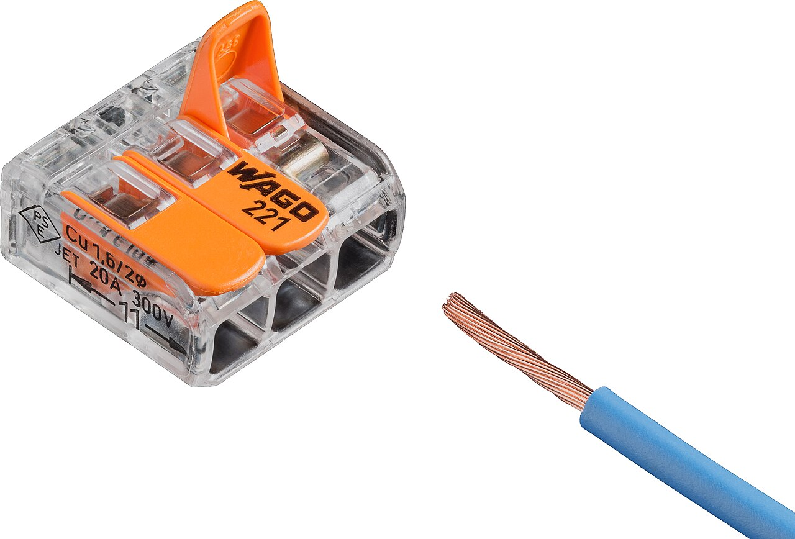
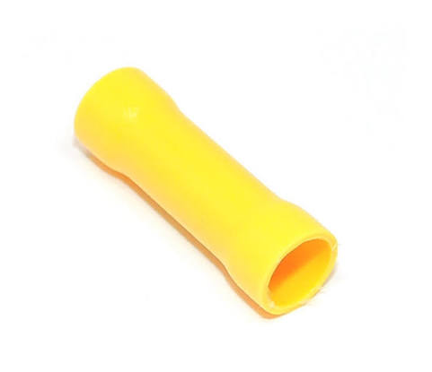
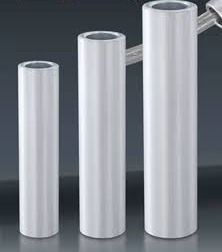

# Connectors

Connectors join two or more wires together. Pick the connector by how much
current the wire carries and whether you'll need to take it apart again.

Photo: [Lucasbosch](https://commons.wikimedia.org/wiki/File:Wago_221-413_splicing_connector_with_stranded_wire_white.jpg),
[CC BY-SA 4.0](https://creativecommons.org/licenses/by-sa/4.0/), via Wikimedia Commons
{ .item__credit }

## Wago

Lever connector, "lever nut", Wago 221
{ .item__aka }

A splice connector that needs no tools. Strip the wire, lift the orange lever,
push the wire in and close the lever: a spring clamp holds it. Versions with
2, 3 or 5 ports join several wires at one point, and the clear housing lets you
see the copper is fully inserted.

**Used for:** joining and splitting low-current wires, such as power to LEDs,
sensors or a custom board. Quick to undo, which makes it handy for prototyping
and pit repairs.

- The common 221 series takes about 24–12 AWG, solid or stranded. Check the
  rating printed on the connector.
- Strip to the length marked on the side of the housing (11 mm on the 221
  series).
- Tug-test each wire, then fasten the connector down so it can't flap around
  and snag its lever open.
- Not for the main battery wiring.

## Insulated butt splice connector

Butt connector
{ .item__aka }

A metal tube inside a plastic sleeve that joins two wires end to end. Push a
stripped wire into each end and crimp each side. The **heat-shrink** version,
lined with glue, seals the joint and holds the wire better than the plain
plastic version.

**Used for:** signal and low-current wires. Avoid it on motor power and use
Anderson Powerpole connectors there instead.

**Crimp with:** a [crimper for insulated terminals](tools.md#crimper). Match
the dot on the jaw to the splice color.

| Color | Size code | Wire size |
|---|---|---|
| :red_circle: Red | BV1.25 | 22–16 AWG (0.5–1.5 mm²) |
| :blue_circle: Blue | BV2 | 16–14 AWG (1.5–2.5 mm²) |
| :yellow_circle: Yellow | BV5.5 | 12–10 AWG (4–6 mm²) |

The color code is the same internationally.

## Copper crimp tube

冷压铜管, non-insulated butt splice
{ .item__aka }

A bare metal tube that joins two wires end to end. Push a stripped wire into
each end and crimp each half. It has no insulation of its own, so it always
gets a **heat shrink tube** over it. It's slimmer than an insulated butt
splice, so the joint lies flat along the wire.

**Used for:** joining [CAN wires](signal-wiring.md#how-to-wire) inside one
subsystem, where the joint never needs to come apart.

**Crimp with:** a crimper for non-insulated terminals, not the
[color-dot crimper](tools.md#crimper), which is shaped for plastic sleeves.

- Slide the heat shrink onto one wire **before** crimping. It can't go on
  afterwards.
- Tug-test both wires, then shrink the tube over the joint so it covers the
  bare metal and a little insulation on each side.

