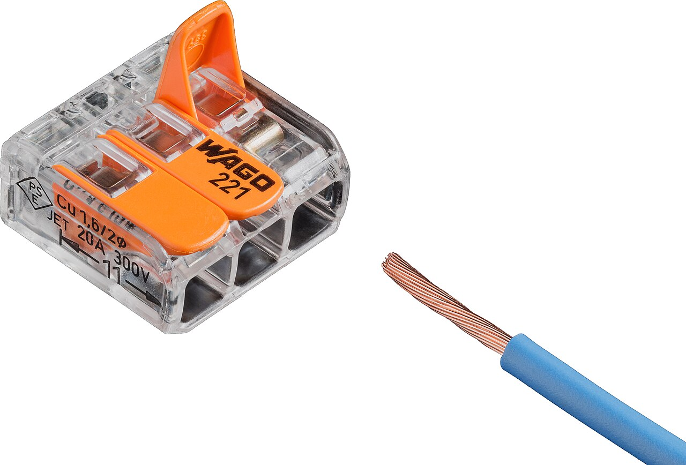
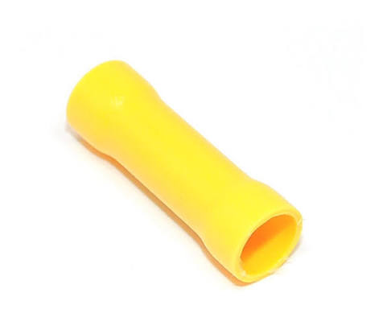
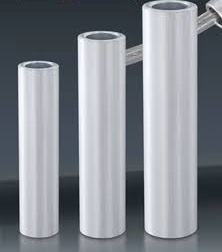

# 连接器 { #connectors }

连接器把两根或更多的线连在一起。选哪种连接器，要看线上的电流有多大，以及以后还要不要拆开。

照片：[Lucasbosch](https://commons.wikimedia.org/wiki/File:Wago_221-413_splicing_connector_with_stranded_wire_white.jpg)，[CC BY-SA 4.0](https://creativecommons.org/licenses/by-sa/4.0/)，来自 Wikimedia Commons
{ .item__credit }

## Wago { #wago }

快速接线器、杠杆式接线端子、Wago 221
{ .item__aka }

一种不用工具的接线器。剥好线，抬起橙色拨杆，把线插进去，再压下拨杆：里面的弹簧夹会夹住线。有 2、3、5 孔的版本，可以把几根线接在同一个点上，透明外壳能让你看到铜线是否完全插到底。

**用于：**连接和分接小电流的线，比如给 LED、传感器或自制电路板供电。拆起来很快，所以做原型和在维修区修车时很方便。

- 常用的 221 系列适用约 24–12 AWG 的单股或多股线。以接线器上印的规格为准。
- 按外壳侧面标的长度剥线（221 系列是 11 mm）。
- 每根线都拽一下测试，然后把接线器固定住，这样它不会晃来晃去，把拨杆挂开。
- 不能用于电池主线。

## 绝缘对接端子 { #insulated-butt-splice-connector }

对接端子、中接端子
{ .item__aka }

塑料套管里的一根金属管，把两根线首尾相接。从两端各插进一根剥好的线，两边分别压接。**热缩**版本里面衬有胶，能密封接头，而且比普通塑料版本抓线更牢。

**用于：**信号线和小电流的线。电机电源线上不要用它，那里用 Anderson Powerpole 连接器。

**用什么压：**[绝缘端子用的压线钳](tools.md#crimper)。让钳口上的圆点颜色和端子颜色对应。

| 颜色 | 型号 | 线径 |
|---|---|---|
| :red_circle: 红色 | BV1.25 | 22–16 AWG（0.5–1.5 mm²） |
| :blue_circle: 蓝色 | BV2 | 16–14 AWG（1.5–2.5 mm²） |
| :yellow_circle: 黄色 | BV5.5 | 12–10 AWG（4–6 mm²） |

这套颜色代码在国际上是通用的。

## 冷压铜管 { #copper-crimp-tube }

非绝缘对接端子
{ .item__aka }

一根裸金属管，把两根线首尾相接。从两端各插进一根剥好的线，两半分别压接。它本身没有绝缘，所以外面一定要套**热缩管**。它比绝缘对接端子细，所以接头能平贴在线上。

**用于：**在同一个子系统内部连接 [CAN 线](signal-wiring.md#how-to-wire)，这些接头永远不需要拆开。

**用什么压：**非绝缘端子用的压线钳，不要用[彩色圆点压线钳](tools.md#crimper)，那种是为塑料套管设计的。

- 压接**之前**先把热缩管套到一根线上。压完以后就套不上了。
- 两根线都拽一下测试，然后把热缩管收缩在接头上，盖住裸露的金属和两边的一点绝缘层。

