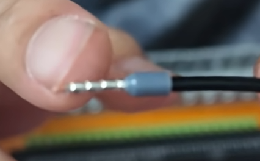
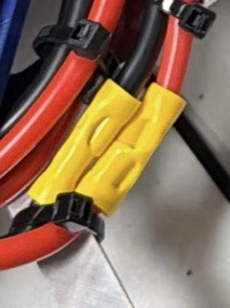

# Power wiring

Every device on the robot gets its power through a loop: current flows from
the battery out along a red wire, through the device, and back to the battery
along a black wire. This page explains the wires and the order they connect in.
For the full build steps, follow WPILib's
[Introduction to FRC Robot Wiring](https://docs.wpilib.org/en/stable/docs/zero-to-robot/step-1/intro-to-frc-robot-wiring.html).

<figure class="diagram" markdown="span">
  
  <figcaption>
    The whole control system, with REV electronics. Click to open it full size. 
    Diagram: FRC Team 3161 and Stefen Acepcion, via
    <a href="https://docs.wpilib.org/en/stable/docs/zero-to-robot/step-1/intro-to-frc-robot-wiring.html">WPILib</a>
  </figcaption>
</figure>

## Red and black wires

Power wire comes as a **red and black pair**: two wires bonded side by side.
Red is positive (+) and black is negative (−), so you can tell them apart at
both ends, and the pair stays together on its way across the robot.

- Always connect red to + and black to −. A device wired backwards can be
  destroyed the moment the robot turns on.
- The game manual requires power wires to be color-coded by polarity, and
  inspectors check it.

## Wire gauge (AWG)

AWG (American Wire Gauge) is the thickness of the copper. The **smaller the
number, the thicker the wire**: every 3 gauges smaller doubles the copper. A
thicker wire carries more current without getting hot.

Each wire is protected by the breaker or fuse at its start, which cuts the
power before the wire overheats. So the breaker sets how thick the wire must
be:

| Breaker or fuse | Minimum wire | Metric (approx.) | Used for |
|---|---|---|---|
| 120 A main breaker | 6 AWG | 13.3 mm² | Battery → main breaker → PDH/PDP |
| 31–40 A | 12 AWG | 3.3 mm² | Motor controllers |
| 21–30 A | 14 AWG | 2.1 mm² | Smaller motors |
| 6–20 A | 18 AWG | 0.8 mm² | roboRIO, radio, pneumatics hub |
| 5 A or less | 22 AWG | 0.3 mm² | LEDs, small sensors |

- These are minimums from the game manual's wire size rule. It changes from
  year to year, so check this season's manual.
- Thicker than the minimum is always allowed. WPILib uses 10 AWG for motor
  controllers, which loses less voltage than 12 AWG.

## Battery to PDH/PDP

Step-by-step:
[Attach robot-side battery connector](https://docs.wpilib.org/en/stable/docs/zero-to-robot/step-1/intro-to-frc-robot-wiring.html#attach-robot-side-battery-connector)
and the steps after it.

Both wires are 6 AWG:

| Wire | Path |
|---|---|
| :black_circle: Black (−) | Battery → PDH/PDP negative input |
| :red_circle: Red (+) | Battery → 120 A main breaker → PDH/PDP positive input |

- The main breaker is also the robot's on/off switch.
- The wires bolt onto the main breaker with
  [copper cable lugs](wire-terminals.md#copper-cable-lug), crimped with a
  [hydraulic crimper](tools.md#hydraulic-crimper).
- Wrap electrical tape over both main breaker terminals so nothing metal can
  touch them.

## PDH/PDP to devices

Step-by-step:
[Motor controller power](https://docs.wpilib.org/en/stable/docs/zero-to-robot/step-1/intro-to-frc-robot-wiring.html#motor-controller-power),
[roboRIO power](https://docs.wpilib.org/en/stable/docs/zero-to-robot/step-1/intro-to-frc-robot-wiring.html#roborio-power)
and [radio power](https://docs.wpilib.org/en/stable/docs/zero-to-robot/step-1/intro-to-frc-robot-wiring.html#radio-power).

1.  **Add a breaker or fuse** to the channel: a 40 A breaker for a motor
    controller, a 10 A fuse for the roboRIO or radio.
2.  { .step-photo }
    **Crimp ferrules onto the wires that go into the PDH/PDP.** Usually these
    are the device's own power wires, such as the ones on a motor controller
    or a motor with a built-in controller. If they're too short to reach the
    PDH/PDP, cut a red and black extension pair instead (gauge from the table
    above) and crimp onto one end of it. Use a
    [ferrule crimper](tools.md#ferrule-crimper). Without a
    [ferrule](wire-terminals.md#wire-ferrule), the strands spread out as the
    terminal clamps down, and a stray one can short to the next terminal. A
    finished ferrule looks like the photo:

    - The plastic collar touches the wire's insulation.
    - The metal tube covers every strand, with none poking out.
    - It doesn't pull off when you tug it.

3.  **Push the ferrules into the channel's terminals**, red to + and black
    to −.
4.  { .step-photo .step-photo--tall }
    **If you used an extension pair, join it to the device's power wires**
    with a [connector](connectors.md): red to red, black to black. If the
    device's own wires reached the PDH/PDP, you're done, and no connector is
    needed.

    The photo shows an extension joined with
    [insulated butt splices](connectors.md#insulated-butt-splice-connector).
    The wires are zip-tied on both sides of the splices, so a tug on the wire
    doesn't pull on the crimp.
