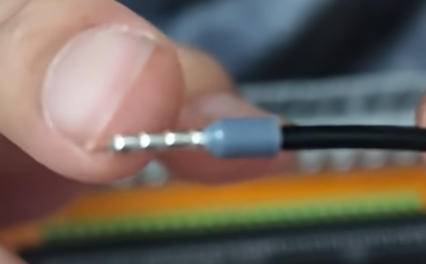
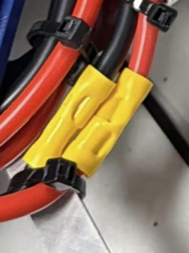

# 电源接线 { #power-wiring }

机器人上的每个设备都通过一个回路取电：电流从电池出发，沿红线流出，经过设备，再沿黑线回到电池。这一页讲解用到的线，以及它们的连接顺序。完整的装配步骤请看 WPILib 的 [Introduction to FRC Robot Wiring](https://docs.wpilib.org/en/stable/docs/zero-to-robot/step-1/intro-to-frc-robot-wiring.html)（FRC 机器人接线入门）。

<figure class="diagram" markdown="span">
  
  <figcaption>
    整个控制系统，使用 REV 的电控元件。点击可以查看大图。 
    图：FRC 3161 队和 Stefen Acepcion，来自
    <a href="https://docs.wpilib.org/en/stable/docs/zero-to-robot/step-1/intro-to-frc-robot-wiring.html">WPILib</a>
  </figcaption>
</figure>

## 红黑线 { #red-and-black-wires }

电源线是**红黑双色并线**：两根线并排粘在一起。红色是正极（+），黑色是负极（−），这样两端都能分清，而且这一对线在机器人上走线时也始终在一起。

- 一定要红线接 +，黑线接 −。接反的设备可能在机器人通电的一瞬间就烧坏。
- 比赛规则手册要求电源线按极性用颜色区分，检录时会检查。

## 线规（AWG） { #wire-gauge-awg }

AWG（美国线规）表示铜芯的粗细。**数字越小，线越粗**：每小 3 号，铜的截面积就翻一倍。线越粗，能通过的电流越大，也越不容易发热。

每根线都由它起点处的断路器或保险丝保护，在线过热之前切断电源。所以线需要多粗，由断路器决定：

| 断路器或保险丝 | 最小线规 | 公制（约） | 用于 |
|---|---|---|---|
| 120 A 主断路器 | 6 AWG | 13.3 mm² | 电池 → 主断路器 → PDH/PDP |
| 31–40 A | 12 AWG | 3.3 mm² | 电机控制器 |
| 21–30 A | 14 AWG | 2.1 mm² | 较小的电机 |
| 6–20 A | 18 AWG | 0.8 mm² | roboRIO、无线网桥、气动模块 |
| 5 A 或更小 | 22 AWG | 0.3 mm² | LED、小型传感器 |

- 这些是比赛规则手册中线径规则规定的最小值。规则每年都会变，请查看本赛季的手册。
- 比最小值更粗的线永远是允许的。WPILib 给电机控制器用 10 AWG 的线，压降比 12 AWG 更小。

## 电池到 PDH/PDP { #battery-to-pdhpdp }

分步说明：[Attach robot-side battery connector](https://docs.wpilib.org/en/stable/docs/zero-to-robot/step-1/intro-to-frc-robot-wiring.html#attach-robot-side-battery-connector)（安装机器人端的电池接头）及其后面的步骤。

两根线都是 6 AWG：

| 线 | 路径 |
|---|---|
| :black_circle: 黑线（−） | 电池 → PDH/PDP 负极输入 |
| :red_circle: 红线（+） | 电池 → 120 A 主断路器 → PDH/PDP 正极输入 |

- 主断路器也是机器人的电源开关。
- 线通过[铜鼻子](wire-terminals.md#copper-cable-lug)用螺栓固定在主断路器上，铜鼻子用[液压压线钳](tools.md#hydraulic-crimper)压接。
- 用电工胶布把主断路器的两个端子都缠起来，这样任何金属都碰不到它们。

## PDH/PDP 到设备 { #pdhpdp-to-devices }

分步说明：[Motor controller power](https://docs.wpilib.org/en/stable/docs/zero-to-robot/step-1/intro-to-frc-robot-wiring.html#motor-controller-power)（电机控制器供电）、[roboRIO power](https://docs.wpilib.org/en/stable/docs/zero-to-robot/step-1/intro-to-frc-robot-wiring.html#roborio-power)（roboRIO 供电）和 [radio power](https://docs.wpilib.org/en/stable/docs/zero-to-robot/step-1/intro-to-frc-robot-wiring.html#radio-power)（无线网桥供电）。

1.  **给通道装上断路器或保险丝**：电机控制器用 40 A 断路器，roboRIO 或无线网桥用 10 A 保险丝。
2.  { .step-photo }
    **给要插进 PDH/PDP 的线压上管型端子。**这些通常就是设备自带的电源线，比如电机控制器上的线，或者内置控制器的电机上的线。如果它们太短，够不到 PDH/PDP，就另外剪一对红黑延长线（线规按上面的表），压接在它的一端。使用[管型端子压线钳](tools.md#ferrule-crimper)。如果不用[管型端子](wire-terminals.md#wire-ferrule)，端子夹紧时线芯会散开，散出来的一根就可能和旁边的端子短路。压好的管型端子应该像照片里那样：

    - 塑料套管紧贴着线的绝缘层。
    - 金属管包住了所有线芯，没有一根露出来。
    - 用力拽也拽不下来。

3.  **把管型端子插进通道的端子里**，红线接 +，黑线接 −。
4.  { .step-photo .step-photo--tall }
    **如果用了延长线，把它和设备的电源线接起来**，用一个[连接器](connectors.md)：红接红，黑接黑。如果设备自带的线够得到 PDH/PDP，到这里就完成了，不需要连接器。

    照片里的延长线是用[绝缘对接端子](connectors.md#insulated-butt-splice-connector)接起来的。对接端子两侧都用扎带把线扎住，这样拽线时不会拉到压接的地方。
