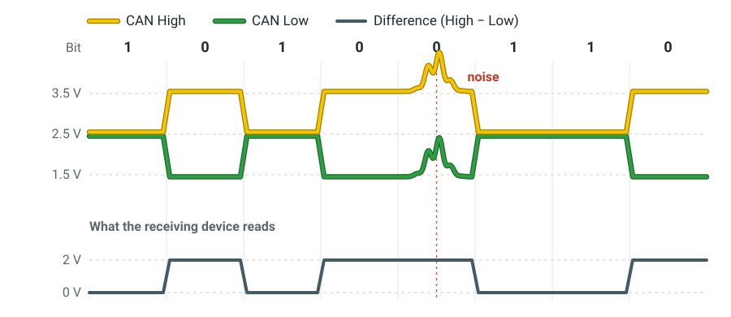
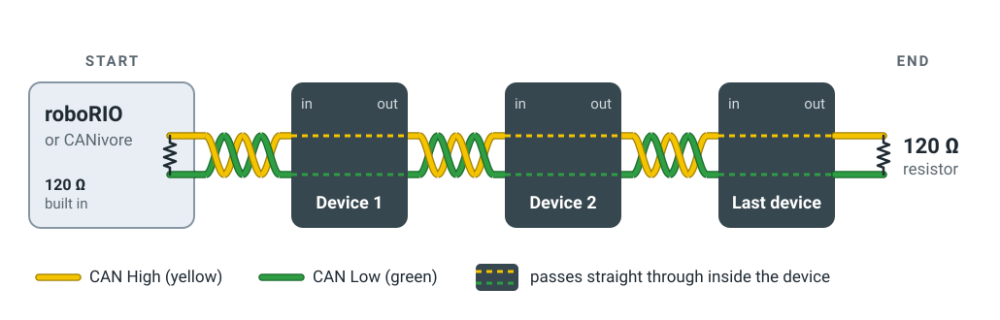
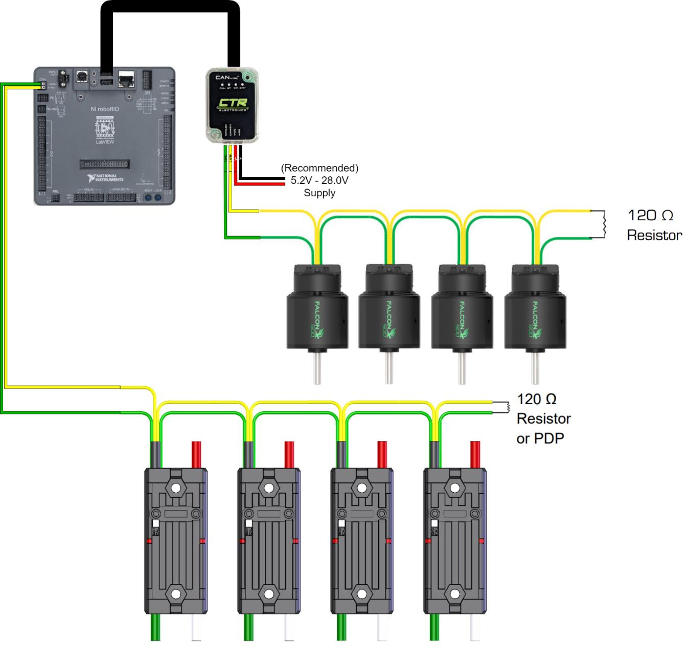

# Signal wiring

Power wires feed each device; signal wires tell it what to do. The roboRIO
sends commands to motor controllers and reads sensors over two kinds of signal
wiring: **CAN**, which most devices use, and **PWM**.

## CAN devices

Most motor controllers and sensors on an FRC robot are CAN devices: Talon FX,
SPARK MAX, CANcoder, Pigeon 2, the PDH and the pneumatics hub. They all share
one pair of wires, the **CAN bus**, and each one has its own ID number so the
roboRIO can tell them apart.

### Wire

CAN uses **22 AWG yellow and green wire, twisted together**:

| Wire | Signal |
|---|---|
| :yellow_circle: Yellow | CAN High (CAN H) |
| :green_circle: Green | CAN Low (CAN L) |

- Always connect yellow to yellow and green to green, at every joint.
- Keep the pair twisted right up to the terminals. The next section explains
  why.

### How CAN works

Every device on the bus listens on the same two wires. To send a message, a
device switches the wires between two states, about a million times a second:

- **Apart:** CAN High goes up to about 3.5 V and CAN Low goes down to about
  1.5 V. This is a 0.
- **Together:** both wires sit at about 2.5 V. This is a 1, and it's also the
  state of a quiet bus.

The receiving device doesn't measure either wire on its own. It only reads the
**difference** between them, High minus Low: about 2 V or about 0 V.

<figure class="diagram" markdown="span">
  
  <figcaption>
    A burst of noise pushes both wires up by the same amount, so the
    difference doesn't change.
  </figcaption>
</figure>

**Why the wires are twisted:** motors and the big power wires near them give
off electrical noise, which pushes the voltage on nearby wires up and down.
Twisting keeps the two CAN wires side by side and swaps them over every twist,
so the noise hits both equally. Both voltages move together, the difference
stays the same, and the message gets through.

### How to wire

Step-by-step:
[CAN bus connections – SPARK MAXes](https://docs.wpilib.org/en/stable/docs/zero-to-robot/step-1/intro-to-frc-robot-wiring.html#can-bus-connections-spark-maxes)
and
[CAN bus connections – PDH and roboRIO](https://docs.wpilib.org/en/stable/docs/zero-to-robot/step-1/intro-to-frc-robot-wiring.html#can-bus-connections-pdh-and-roborio).

The CAN bus is **one chain**: it starts at the roboRIO or a CANivore, goes into
and out of each device in turn, and ends at a 120 Ω resistor.

<figure class="diagram" markdown="span">
  
  <figcaption>
    A 120 Ω resistor at each end: one built into the roboRIO or CANivore, one
    after the last device.
  </figcaption>
</figure>

Both ends need a resistor because a signal that reaches the end of a wire
bounces back, like an echo, and the echo garbles the next bit. A 120 Ω resistor
between yellow and green soaks it up.

1.  **Start at the roboRIO or a CANivore.** Push yellow into CAN H and green
    into CAN L. Both have the first 120 Ω resistor built in. A CANivore plugs
    into the roboRIO by USB and runs a second bus of its own, for CTRE devices
    only.

2.  **Go into and out of each device**, yellow to yellow and green to green.
    Keep it one line: no branches off to the side, and the last device never
    comes back to the start.

3.  **Join the wires** wherever one device's CAN wires don't reach the next.
    The connector depends on where the joint is:

    | Joint | Connector |
    |---|---|
    | Inside one subsystem | [Copper crimp tube](connectors.md#copper-crimp-tube) (冷压铜管) with heat shrink over it |
    | Between two subsystems | [Wago](connectors.md#wago): one for yellow, one for green |

    A crimped joint is small and permanent. A Wago opens without tools, so a
    subsystem can come off the robot without cutting the bus.

4.  **End with a 120 Ω resistor** between yellow and green after the last
    device, covered in heat shrink. On the roboRIO's bus, the PDH can be the
    end instead, with its TERM switch ON. A PDH in the middle of the bus must
    have TERM OFF.

5.  **Check it.** With the robot off, the resistance between yellow and green
    on the roboRIO's bus should be about **60 Ω**. About 120 Ω means one end
    is missing its resistor. More checks are in CTRE's
    [CAN bus troubleshooting](https://v6.docs.ctr-electronics.com/en/stable/docs/troubleshooting/canbus-troubleshooting.html).

With real devices, it looks like this. The robot below has two separate buses:

<figure class="diagram" markdown="span">
  
  <figcaption>
    Bottom: the roboRIO's bus runs through four Talon SRX motor controllers
    and ends at a 120 Ω resistor or the PDP. Top: a CANivore, plugged into the
    roboRIO by USB, runs its own bus through four Falcon 500 motors to a
    120 Ω resistor. 
    Diagram: CTR Electronics, from the
    <a href="https://ctre.download/files/user-manual/CANivore%20User's%20Guide.pdf">CANivore User's Guide</a>
  </figcaption>
</figure>

## PWM devices

!!! note "Coming soon"

    This section hasn't been written yet.
