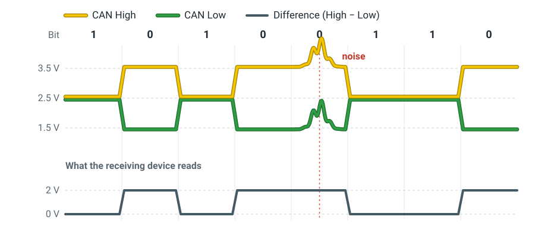
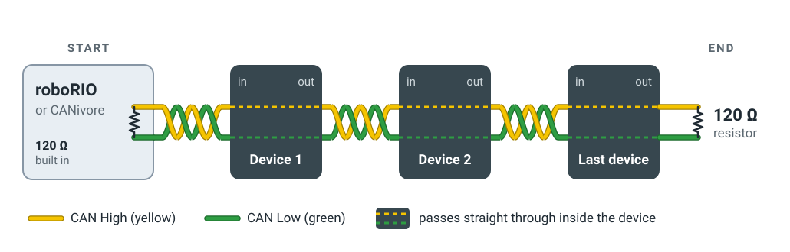
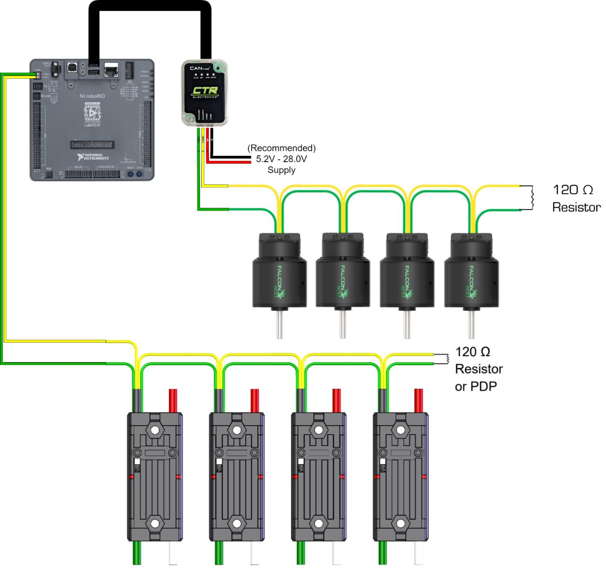

# 信号接线 { #signal-wiring }

电源线给每个设备供电；信号线告诉它该做什么。roboRIO 通过两种信号线给电机控制器发送指令、读取传感器：大多数设备用的 **CAN**，以及 **PWM**。

## CAN 设备 { #can-devices }

FRC 机器人上的大多数电机控制器和传感器都是 CAN 设备：Talon FX、SPARK MAX、CANcoder、Pigeon 2、PDH 和气动模块。它们共用一对线，也就是 **CAN 总线**，每个设备都有自己的 ID 号，这样 roboRIO 就能区分它们。

### 线 { #wire }

CAN 使用 **22 AWG 的黄绿双绞线**：

| 线 | 信号 |
|---|---|
| :yellow_circle: 黄线 | CAN High（CAN H） |
| :green_circle: 绿线 | CAN Low（CAN L） |

- 在每一个接头处，都要黄接黄、绿接绿。
- 让这对线一直绞在一起，直到端子跟前。下一节会解释为什么。

### CAN 的工作原理 { #how-can-works }

总线上的每个设备都在监听同样的两根线。要发送消息时，设备会在两种状态之间切换这两根线，每秒大约一百万次：

- **分开：**CAN High 升到约 3.5 V，CAN Low 降到约 1.5 V。这表示 0。
- **合拢：**两根线都在约 2.5 V。这表示 1，也是总线空闲时的状态。

接收的设备不会单独测量任何一根线。它只读两根线之间的**电压差**，也就是 High 减 Low：约 2 V 或约 0 V。

<figure class="diagram" markdown="span">
  
  <figcaption>
    一阵噪声把两根线的电压抬高了同样的幅度，所以电压差不变。
  </figcaption>
</figure>

**为什么要绞在一起：**电机和它们旁边的粗电源线会产生电气噪声，让附近导线上的电压忽高忽低。绞线让两根 CAN 线始终并排，而且每绞一圈就互换一次位置，所以噪声对两根线的影响是一样的。两根线的电压一起变化，电压差保持不变，消息就能正常传过去。

### 怎样接线 { #how-to-wire }

分步说明：[CAN bus connections – SPARK MAXes](https://docs.wpilib.org/en/stable/docs/zero-to-robot/step-1/intro-to-frc-robot-wiring.html#can-bus-connections-spark-maxes)（CAN 总线连接：SPARK MAX）和 [CAN bus connections – PDH and roboRIO](https://docs.wpilib.org/en/stable/docs/zero-to-robot/step-1/intro-to-frc-robot-wiring.html#can-bus-connections-pdh-and-roborio)（CAN 总线连接：PDH 和 roboRIO）。

CAN 总线是**一条链**：从 roboRIO 或 CANivore 开始，依次进出每个设备，最后接到一个 120 Ω 电阻上结束。

<figure class="diagram" markdown="span">
  
  <figcaption>
    两端各有一个 120 Ω 电阻：一个内置在 roboRIO 或 CANivore 里，一个接在最后一个设备后面。
  </figcaption>
</figure>

两端都需要电阻，是因为信号到达导线末端时会像回声一样反射回来，回声会干扰下一个比特。黄绿线之间接一个 120 Ω 电阻就能把它吸收掉。

1.  **从 roboRIO 或 CANivore 开始。**黄线插进 CAN H，绿线插进 CAN L。两者都内置了第一个 120 Ω 电阻。CANivore 通过 USB 接到 roboRIO 上，自己再带一条独立的总线，只能接 CTRE 的设备。

2.  **依次进出每个设备**，黄接黄，绿接绿。保持一条线走到底：不要往旁边分叉，最后一个设备也不要再接回起点。

3.  **在一个设备的 CAN 线够不到下一个设备的地方把线接起来。**用哪种连接器取决于接头的位置：

    | 接头 | 连接器 |
    |---|---|
    | 在同一个子系统内部 | [冷压铜管](connectors.md#copper-crimp-tube)，外面套热缩管 |
    | 在两个子系统之间 | [Wago](connectors.md#wago)：黄线一个，绿线一个 |

    压接的接头小而且是永久的。Wago 不用工具就能打开，所以拆下一个子系统时不用剪断总线。

4.  **在最后一个设备后面接一个 120 Ω 电阻**，跨接在黄绿线之间，外面套上热缩管。在 roboRIO 的总线上，也可以用 PDH 作为末端，把它的 TERM 开关拨到 ON。在总线中间的 PDH 必须把 TERM 拨到 OFF。

5.  **检查。**机器人断电时，roboRIO 总线上黄绿线之间的电阻应该约为 **60 Ω**。如果约为 120 Ω，说明有一端缺了电阻。更多检查方法见 CTRE 的 [CAN bus troubleshooting](https://v6.docs.ctr-electronics.com/en/stable/docs/troubleshooting/canbus-troubleshooting.html)（CAN 总线故障排查）。

接上真实设备后是这样的。下面这台机器人有两条独立的总线：

<figure class="diagram" markdown="span">
  
  <figcaption>
    下方：roboRIO 的总线经过四个 Talon SRX 电机控制器，结束于一个 120 Ω 电阻或 PDP。上方：一个通过 USB 接到 roboRIO 的 CANivore，带着自己的总线经过四个 Falcon 500 电机，接到一个 120 Ω 电阻。 
    图：CTR Electronics，来自
    <a href="https://ctre.download/files/user-manual/CANivore%20User's%20Guide.pdf">CANivore User's Guide</a>（CANivore 用户手册）
  </figcaption>
</figure>

## PWM 设备 { #pwm-devices }

!!! note "即将推出"

    这一节还没有写。
