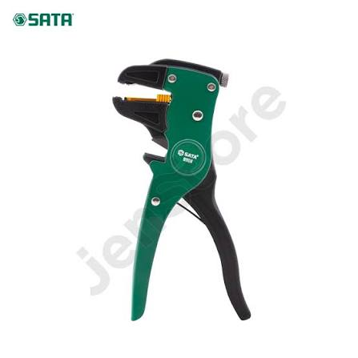
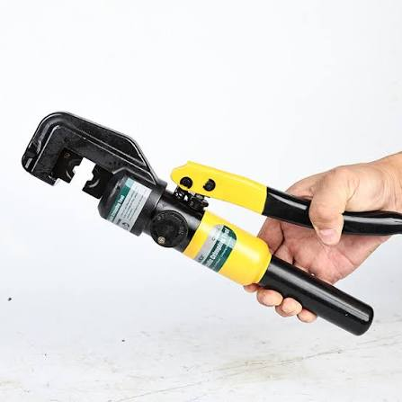
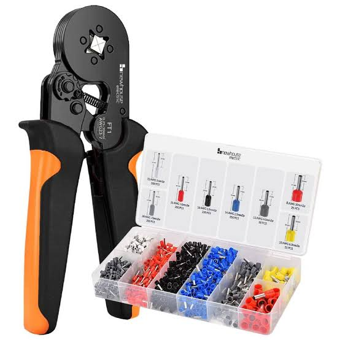
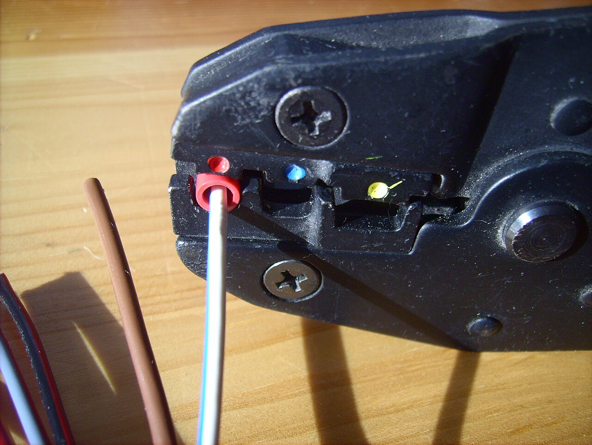
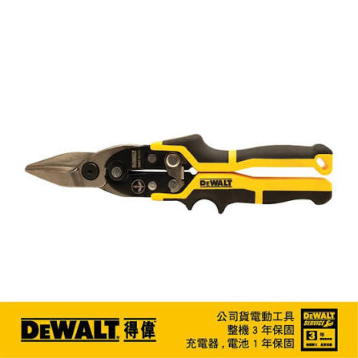
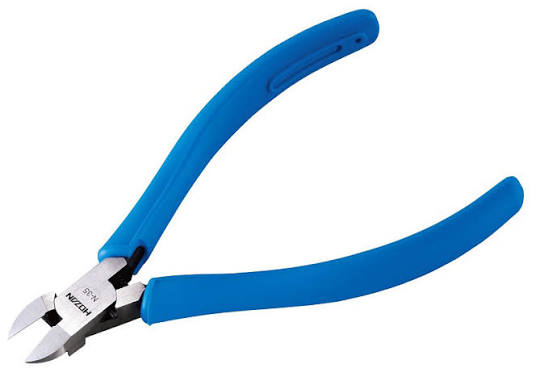

# Tools

The hand tools used for wiring an FRC robot. Each one does one job. Using the
wrong tool is the most common cause of a bad crimp or a crushed wire.

## Wire stripper

Also sold as a *self-adjusting* or *automatic* wire stripper
{ .item__aka }

Removes the insulation from the end of a wire without nicking the copper
strands underneath. A **self-adjusting** stripper grips the wire and pulls the
insulation off in one squeeze, sizing itself to the wire. It is the easiest kind
for rookies. Manual strippers have a row of notches labeled by wire gauge, and
you have to pick the right one.

**Used for:** every wire on the robot, before it gets a ferrule, a splice or a
connector.

- Strip only as much as the terminal needs: the copper should fill the terminal
  with no bare wire showing behind it.
- Look at the strands after stripping. If any are cut, cut the end off and strip
  again.
- Check the wire range printed on the tool. Thick 6 AWG battery wire is usually
  outside it.

## Hydraulic crimper

Hydraulic lug crimper
{ .item__aka }

A hand-pumped hydraulic press for crimping
[copper cable lugs](wire-terminals.md#copper-cable-lug) onto thick wire. Pumping
the handle closes a pair of dies with far more force than any hand crimper,
which is what a 6 AWG battery lug needs. A "4–70" model crimps wire from
4 to 70 mm², and comes with a set of interchangeable dies, one per wire size.

**Used for:** 6 AWG battery wiring: the lugs on the battery terminals and the
120 A main breaker.

- Use the **16 mm²** die for 6 AWG wire.
- Pump until the two dies meet. Many models release pressure on their own when
  the crimp is done. Open the release valve to take the lug out.
- Tug-test the lug, then put heat shrink over the barrel.

## Ferrule crimper

Crimps [wire ferrules](wire-terminals.md#wire-ferrule) onto stranded wire. Most
are **ratcheting** and **self-adjusting**: one set of jaws squeezes any ferrule
in its range into a neat square, and the ratchet won't let go until the crimp
is complete, so you can't half-crimp.

**Used for:** ferrules on wires going into the PDH/PDP and other push-in or
screw terminals.

- Push the wire in until the insulation touches the ferrule's plastic collar.
- Squeeze until the ratchet releases on its own.
- If strands poke out past the end of the ferrule, trim them flush.

Photo: [Hundehalter](https://commons.wikimedia.org/wiki/File:Crimping_tool_04.jpg),
[CC BY-SA 3.0](https://creativecommons.org/licenses/by-sa/3.0/), via Wikimedia Commons
{ .item__credit }

## Crimper

Ratcheting crimper for insulated terminals
{ .item__aka }

The jaws have rounded cavities marked with **red, blue and yellow** dots, one
for each terminal size. The rounded shape squeezes the metal tube inside the
terminal without cutting its plastic sleeve. Like the ferrule crimper, the
ratchet won't open until the crimp is complete.

**Used for:** [insulated butt splices](connectors.md#insulated-butt-splice-connector)
and insulated ring and spade terminals.

- Put the terminal in the cavity with the same color dot as its sleeve.
- Squeeze until the ratchet releases on its own.

## Aviation snips

Tin snips
{ .item__aka }

Compound-lever shears for cutting thin sheet metal and plastic. The handle
color tells you which way it cuts:

| Handle | Cuts |
|---|---|
| :red_circle: Red | Left curves |
| :green_circle: Green | Right curves |
| :yellow_circle: Yellow | Straight lines |

**Used for:** sheet metal and polycarbonate, such as electronics panels and
mounting plates.

!!! danger "Not for wire"
    Snips crush the strands instead of cutting them. Use
    [diagonal cutters](#diagonal-cutters) or cable cutters.

## Diagonal cutters

Side cutters, "dikes"
{ .item__aka }

Pliers with angled blades that pinch straight through wire. **Flush cutters**
are a type of diagonal cutter with one flat side, so they leave a flat cut
instead of a point.

**Used for:** cutting signal and small power wire. Use flush cutters to trim
zip ties: they leave no sharp stub to cut hands or wires.

- Hold the loose end when you cut. Clipped pieces fly.
- Not for 6 AWG. Use **cable cutters**, which cut thick wire cleanly without
  crushing it.

## Which crimper for which terminal

Each crimper only works with its own terminal type. The wrong tool leaves a
loose crimp or cuts through the insulation.

| Terminal | Crimp it with | Photo |
|---|---|---|
| [Copper cable lug](wire-terminals.md#copper-cable-lug) | [Hydraulic crimper](#hydraulic-crimper) | { .table-photo } |
| [Wire ferrule](wire-terminals.md#wire-ferrule) | [Ferrule crimper](#ferrule-crimper) | { .table-photo } |
| [Insulated butt splice](connectors.md#insulated-butt-splice-connector), insulated ring and spade terminals | [Crimper](#crimper) | { .table-photo } |

!!! tip "Crimping rules"
    - Use the crimper made for that terminal.
    - Ratcheting crimpers won't open until the crimp is complete, so you can't
      half-crimp. Squeeze until it releases.
    - Tug-test every crimp.
    - Put heat shrink over lug barrels.
