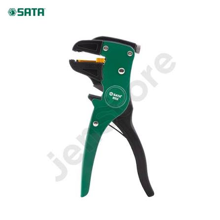
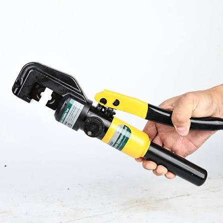
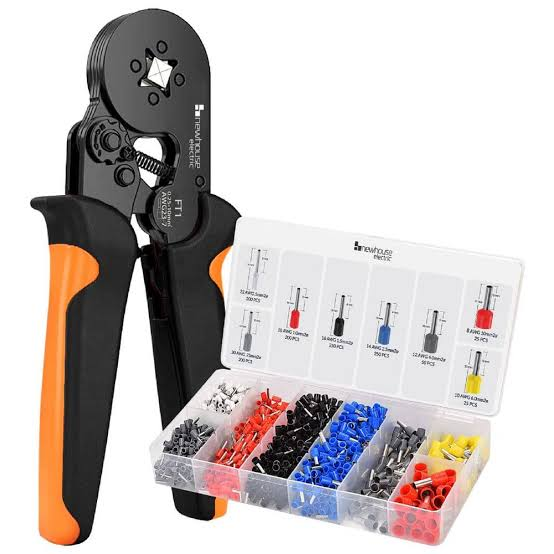
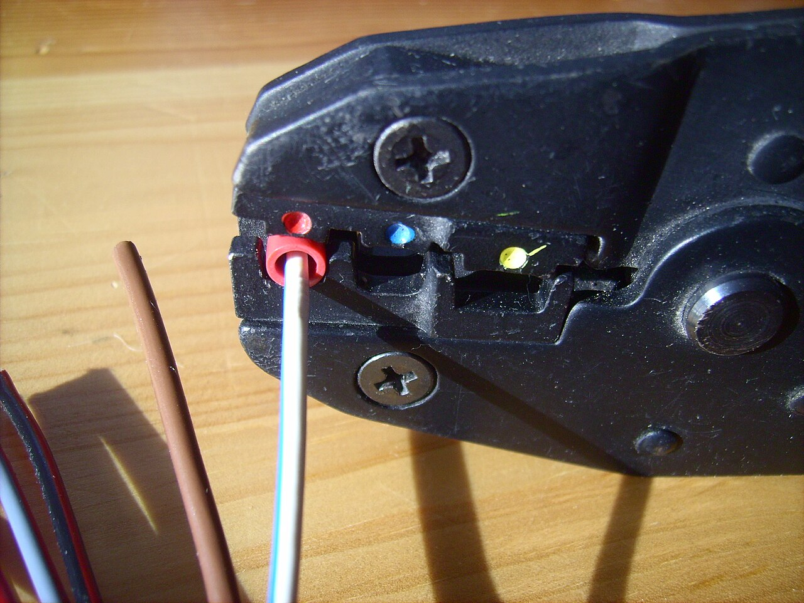
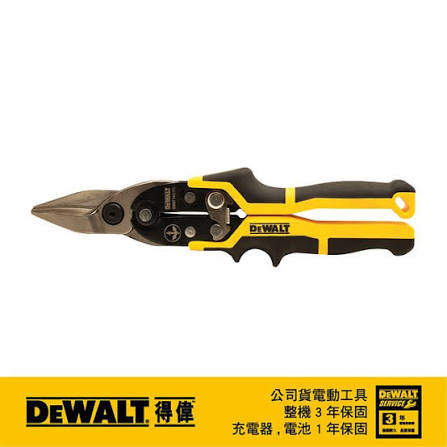
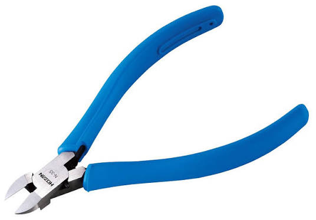

# 工具 { #tools }

给 FRC 机器人接线用的手动工具。每种工具只干一件事。用错工具是压接不良或压坏导线最常见的原因。

## 剥线钳 { #wire-stripper }

也叫*自调节*或*自动*剥线钳
{ .item__aka }

剥掉线头的绝缘层，同时不会割伤下面的铜线芯。**自调节**剥线钳夹住线，捏一下就能把绝缘层拉下来，它会自己适应线的粗细。这是对新手最友好的一种。手动剥线钳上有一排按线规标好的豁口，需要自己选对。

**用于：**机器人上的每一根线，在装管型端子、对接端子或连接器之前。

- 只剥端子需要的长度：铜线芯应该填满端子，端子后面不露出裸线。
- 剥完后看一下线芯。如果有被割断的，把线头剪掉重新剥。
- 看一下工具上印的适用线径。粗的 6 AWG 电池线通常不在范围内。

## 液压压线钳 { #hydraulic-crimper }

液压铜鼻子压线钳
{ .item__aka }

一种手动泵压的液压钳，用来把[铜鼻子](wire-terminals.md#copper-cable-lug)压接到粗线上。压动手柄会让一对模具合拢，力量比任何手动压线钳都大得多，6 AWG 的电池铜鼻子正需要这么大的力。"4–70" 型号可以压 4 到 70 mm² 的线，附带一套可更换的模具，每种线径一个。

**用于：**6 AWG 的电池接线：电池端子和 120 A 主断路器上的铜鼻子。

- 6 AWG 的线用 **16 mm²** 的模具。
- 一直压到两个模具合在一起。很多型号压好后会自动泄压。打开泄压阀就能取出铜鼻子。
- 拽一下铜鼻子测试，然后在管身上套热缩管。

## 管型端子压线钳 { #ferrule-crimper }

把[管型端子](wire-terminals.md#wire-ferrule)压接到多股线上。大多数是**棘轮式**和**自调节**的：同一组钳口能把范围内的任何管型端子压成整齐的方形，而且压接完成之前棘轮不会松开，所以不会压一半。

**用于：**插进 PDH/PDP 以及其他插入式或螺丝式端子的线上的管型端子。

- 把线插进去，直到绝缘层碰到管型端子的塑料套管。
- 一直捏，直到棘轮自己松开。
- 如果有线芯从管型端子末端露出来，把它剪平。

照片：[Hundehalter](https://commons.wikimedia.org/wiki/File:Crimping_tool_04.jpg)，[CC BY-SA 3.0](https://creativecommons.org/licenses/by-sa/3.0/)，来自 Wikimedia Commons
{ .item__credit }

## 压线钳 { #crimper }

绝缘端子用的棘轮压线钳
{ .item__aka }

钳口上有标着**红、蓝、黄**圆点的圆弧形凹槽，每种端子尺寸一个。圆弧形能压紧端子里面的金属管，又不会割破外面的塑料套。和管型端子压线钳一样，压接完成之前棘轮不会打开。

**用于：**[绝缘对接端子](connectors.md#insulated-butt-splice-connector)，以及绝缘环形端子和叉形端子。

- 把端子放进和它套管颜色相同的圆点凹槽里。
- 一直捏，直到棘轮自己松开。

## 航空剪 { #aviation-snips }

铁皮剪
{ .item__aka }

一种复合杠杆剪刀，用来剪薄金属板和塑料。手柄的颜色告诉你它往哪边剪：

| 手柄 | 剪 |
|---|---|
| :red_circle: 红色 | 左弯 |
| :green_circle: 绿色 | 右弯 |
| :yellow_circle: 黄色 | 直线 |

**用于：**金属板和聚碳酸酯板，比如电控板和安装板。

!!! danger "不能剪线"
    剪刀会把线芯压扁而不是剪断。请用[斜口钳](#diagonal-cutters)或电缆剪。

## 斜口钳 { #diagonal-cutters }

偏口钳
{ .item__aka }

刀口斜着的钳子，能把线直接夹断。**水口钳**是斜口钳的一种，有一面是平的，所以剪出来的切口是平的而不是尖的。

**用于：**剪信号线和细电源线。剪扎带时用水口钳：它不会留下扎手或刮伤线的尖茬。

- 剪的时候捏住要剪掉的那一头。剪下来的线头会飞出去。
- 不能剪 6 AWG。要用**电缆剪**，它能把粗线剪得干净利落，不会压扁。

## 哪种压线钳配哪种端子 { #which-crimper-for-which-terminal }

每种压线钳只适用于它自己的那种端子。用错工具会压不紧，或者割破绝缘层。

| 端子 | 用什么压 | 照片 |
|---|---|---|
| [铜鼻子](wire-terminals.md#copper-cable-lug) | [液压压线钳](#hydraulic-crimper) | { .table-photo } |
| [管型端子](wire-terminals.md#wire-ferrule) | [管型端子压线钳](#ferrule-crimper) | { .table-photo } |
| [绝缘对接端子](connectors.md#insulated-butt-splice-connector)、绝缘环形端子和叉形端子 | [压线钳](#crimper) | { .table-photo } |

!!! tip "压接规则"
    - 使用专门为这种端子设计的压线钳。
    - 棘轮压线钳在压接完成之前不会打开，所以不会压一半。一直捏到它松开为止。
    - 每个压接都要拽一下测试。
    - 在铜鼻子的管身上套热缩管。
