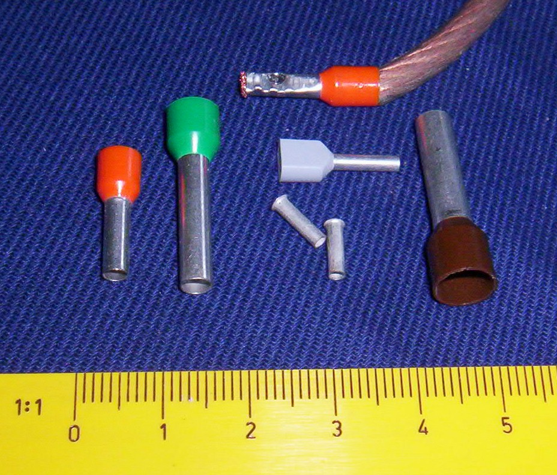
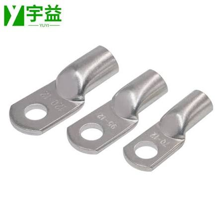

# Wire terminals

A terminal is crimped onto the end of a wire so it can go into a screw
terminal, a push-in socket or onto a bolt. Every terminal has its own crimper:
see [Which crimper for which terminal](tools.md#which-crimper-for-which-terminal).

Photo: [Ulfbastel](https://commons.wikimedia.org/wiki/File:Aderendhuelsen.jpg),
public domain, via Wikimedia Commons
{ .item__credit }

## Wire ferrule

Bootlace ferrule, end-sleeve ferrule; *insulated ferrule* if it has a plastic
collar
{ .item__aka }

A thin tin-plated copper tube crimped over the end of stranded wire. It turns
loose strands into one solid pin, so they can't fray, spread out, or break off
and short against the next terminal. Insulated ferrules have a colored plastic
collar that guides the strands in.

**Used for:** stranded wire going into the PDH/PDP and other push-in or screw
terminals.

**Crimp with:** a [ferrule crimper](tools.md#ferrule-crimper).

- Pick the ferrule by the wire size printed on the bag. Collar colors are not
  the same across brands.
- Strip the wire to the length of the metal tube.

## Copper cable lug

Tinned copper tube lug; teams call it a "battery lug"
{ .item__aka }

A heavy copper tube with a flat ring on the end. The tube is crimped onto thick
wire and the ring is bolted onto a terminal.

**Used for:** 6 AWG battery wiring: the battery terminals and the 120 A main
breaker.

**Crimp with:** a [hydraulic crimper](tools.md#hydraulic-crimper) with the
16 mm² die for 6 AWG.

- Check the lug's barrel fits *flexible* wire, which is thicker than solid
  wire of the same gauge.
- Put heat shrink over the barrel.

!!! warning
    A loose battery lug is a classic cause of a robot losing power mid-match.
    Tighten the bolts and check that no lug can be turned by hand.

