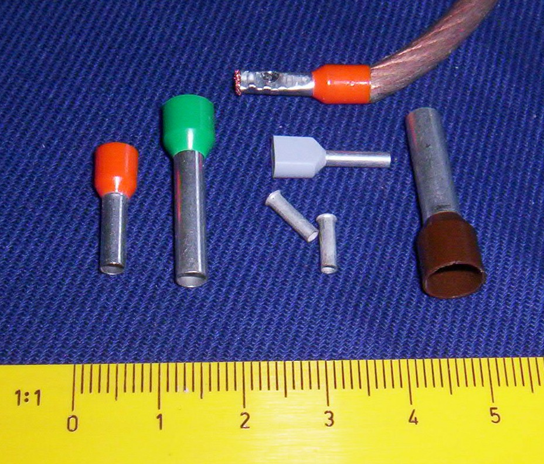
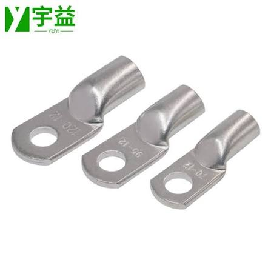

# 线端端子 { #wire-terminals }

端子压接在线头上，让线可以插进螺丝端子、插入式插座，或者用螺栓固定。每种端子都有自己的压线钳：见[哪种压线钳配哪种端子](tools.md#which-crimper-for-which-terminal)。

照片：[Ulfbastel](https://commons.wikimedia.org/wiki/File:Aderendhuelsen.jpg)，公有领域，来自 Wikimedia Commons
{ .item__credit }

## 管型端子 { #wire-ferrule }

针型端子、冷压端子；带塑料套管的叫*绝缘管型端子*
{ .item__aka }

一根压接在多股线末端的镀锡铜细管。它把松散的线芯变成一根结实的针，这样线芯就不会散开、分叉，或者断掉后和旁边的端子短路。绝缘管型端子有一个彩色塑料套管，能引导线芯插进去。

**用于：**插进 PDH/PDP 以及其他插入式或螺丝式端子的多股线。

**用什么压：**[管型端子压线钳](tools.md#ferrule-crimper)。

- 按包装袋上印的线径选管型端子。不同品牌的套管颜色并不统一。
- 剥线长度和金属管的长度一样。

## 铜鼻子 { #copper-cable-lug }

镀锡铜管端子；队员们叫它"电池铜鼻子"
{ .item__aka }

一根粗铜管，末端是一个扁平的圆环。铜管压接在粗线上，圆环用螺栓固定在端子上。

**用于：**6 AWG 的电池接线：电池端子和 120 A 主断路器。

**用什么压：**[液压压线钳](tools.md#hydraulic-crimper)，6 AWG 用 16 mm² 的模具。

- 确认铜鼻子的管身适合*软*线，软线比同线规的硬线更粗。
- 在管身上套热缩管。

!!! warning "注意"
    电池铜鼻子松动，是机器人在比赛中途断电的典型原因。拧紧螺栓，并确认没有哪个铜鼻子能用手转动。

