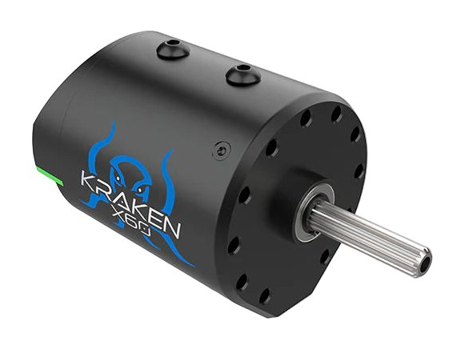
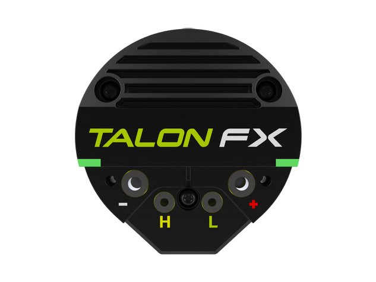
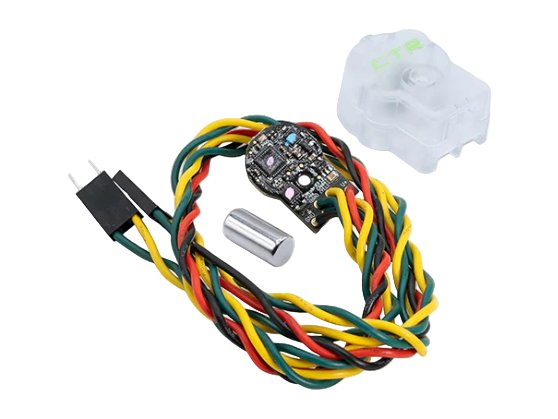
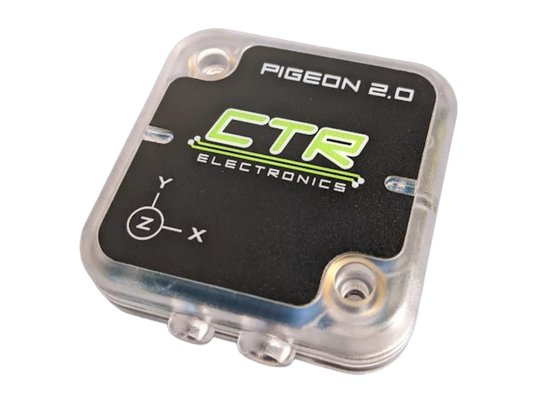
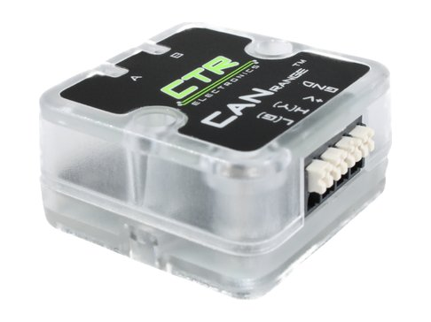
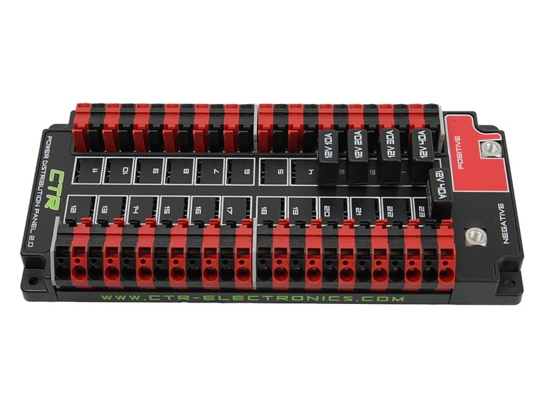
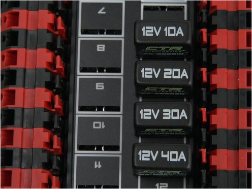
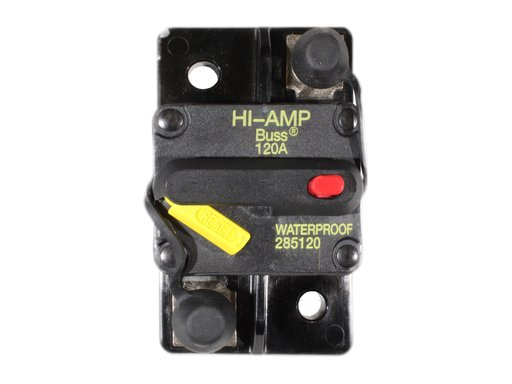
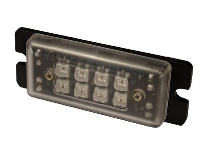

# Common devices

The motors, sensors and power parts most of our robots use, with the specs
that matter when you choose and wire them and what their status lights mean.
All of them except the breakers and the PDP 2.0 are CAN devices from CTR
Electronics (CTRE), set up in Phoenix Tuner X and programmed with Phoenix 6.

## Reading the status lights

Every CTRE CAN device has status lights that blink a code. They're the first
thing to check when a device doesn't work. The lights on this page blink the
same way the real ones do, and most devices share these codes:

| Lights | What it means |
|---|---|
| <i class="led"></i><i class="led"></i> Off | No power. Check the breaker and the red and black wires. |
| <i class="led red-off"></i><i class="led red-off late"></i> Red | No CAN: the device can't hear the roboRIO. See [Troubleshooting](../electronics/troubleshooting.md). |
| <i class="led orange-off"></i><i class="led orange-off"></i> Orange | CAN is working. The robot is disabled, or nothing is controlling the device yet. |
| <i class="led green-off"></i><i class="led green-off late"></i> Green | CAN is working and the device is in use. |
| <i class="led red-orange"></i><i class="led red-orange late"></i> Red and orange | Damaged hardware. Run Self Test in Phoenix Tuner X, then contact CTRE. |
| <i class="led orange-green"></i><i class="led"></i> One light, green and orange | Bootloader: the device needs firmware. Field-upgrade it in Phoenix Tuner X. |

If the lights don't match any code, the device may be switching between two
codes. Most often it's flickering between CAN and no CAN, which means a loose
yellow or green wire.

## Motors and control

Photo: [CTR Electronics](https://store.ctr-electronics.com/products/kraken-x60)
{ .item__credit }

### Kraken X60

Motor, with a Talon FX motor controller built in
{ .item__aka }

Our main motor, for drivetrains, intakes, shooters and elevators. The motor
controller is the back end of the motor, so a Kraken needs only two
connections: red and black to the PDP 2.0, and yellow and green to the CAN
bus.

| | |
|---|---|
| Free speed | 6,000 RPM (5,800 with FOC) |
| Stall torque | 7.09 N·m (9.37 N·m with FOC) |
| Stall current | 366 A (483 A with FOC) |
| Free current | 2 A |
| Peak power | 1,108 W (1,405 W with FOC) |
| Voltage | 6–24 V |
| Weight | 1.2 lb (0.54 kg) |
| Shaft | SplineXS |
| Wires | 10 AWG red and black, 18 in; CAN Y-harness |

- **FOC** is a way of driving the motor that gives more torque for a little
  less top speed. It needs a Phoenix Pro license.
- Use a 40 A breaker. Wire sizes are on [Power wiring](../electronics/power-wiring.md#wire-gauge-awg).
- **Status lights:** the two light strips on the back, either side of the
  TALON FX label. The codes are under [Talon FX](#talon-fx).

[Store page](https://store.ctr-electronics.com/products/kraken-x60) ·
[Docs](https://v6.docs.ctr-electronics.com/en/stable/docs/hardware-reference/talonfx/index.html)

Photo: [CTR Electronics](https://store.ctr-electronics.com/products/kraken-x60)
{ .item__credit }

### Talon FX

Motor controller, built into the Kraken X60
{ .item__aka }

A motor controller takes the roboRIO's commands from the CAN bus and turns
battery power into the right amount of power for the motor. In a Kraken X60
it's built into the back of the motor, so there's no separate box to mount.
The wires screw onto the terminals shown: **−** and **+** for power, **H** and
**L** for CAN.

| | |
|---|---|
| Control | CAN or PWM, detected automatically |
| Built-in PID | Runs at 1 kHz on the controller |
| Commutation | Trapezoidal, or FOC with Phoenix Pro |
| Power terminals | #6-32 Torx screws |
| CAN terminals | #4-40 Torx screws |
| Software | Phoenix 6, set up in Phoenix Tuner X |

Status lights
{ .item__subhead }

=== "Robot disabled"

    | Lights | What it means | What to do |
    |---|---|---|
    | <i class="led"></i><i class="led"></i> Off | No power | Check the breaker and the red and black wires. |
    | <i class="led red-off"></i><i class="led red-off late"></i> Red, taking turns | No CAN or PWM signal | Check the yellow and green wires, and that the roboRIO is on. See [Troubleshooting](../electronics/troubleshooting.md). |
    | <i class="led orange-off"></i><i class="led orange-off late"></i> Orange, taking turns | CAN is working, but no Phoenix code is running on the roboRIO | Deploy robot code that uses Phoenix. |
    | <i class="led orange-off"></i><i class="led orange-off"></i> Orange, together | CAN is working, robot disabled | Nothing: this is normal. |

=== "Robot enabled"

    | Lights | What it means |
    |---|---|
    | <i class="led orange"></i><i class="led orange"></i> Solid orange | Enabled, but told to output 0. If it should be moving, check your code sends it a control request. |
    | <i class="led green-off"></i><i class="led green-off"></i> Green, together | Driving forward. The faster the blink, the more power. |
    | <i class="led red-off"></i><i class="led red-off"></i> Red, together | Driving in reverse. The faster the blink, the more power. |
    | <i class="led red-off"></i><i class="led"></i> Red on one side | Stopped at a forward or reverse soft limit. |

=== "Problems"

    | Lights | What it means | What to do |
    |---|---|---|
    | <i class="led orange-off"></i><i class="led"></i> Orange on one side | Too hot: it has shut off to cool down | Let it cool. Lower its stator current limit. |
    | <i class="led red-green"></i><i class="led red-green late"></i> Red and green | Code used a Phoenix Pro feature, but the motor has no Pro license | License the motor, or don't use that feature. |
    | <i class="led red-orange"></i><i class="led red-orange late"></i> Red and orange | Damaged hardware | Run Self Test in Phoenix Tuner X, then contact CTRE. |
    | <i class="led orange-green"></i><i class="led"></i> One light, green and orange | Bootloader: it needs firmware | Field-upgrade it in Phoenix Tuner X. |

## Sensors

Photo: [CTR Electronics](https://store.ctr-electronics.com/products/cancoder)
{ .item__credit }

### CANcoder

Magnetic encoder
{ .item__aka }

Measures the angle of a shaft. A small magnet on the end of the shaft spins
over the CANcoder's chip. It's **absolute**: it knows the angle the moment it
turns on, without the shaft having to move to a starting point. On a swerve
module, it tells the robot which way the wheel is pointing.

| | |
|---|---|
| Measures | Position and speed of the magnet |
| Magnet strength | Best at 45–75 mT; works less accurately from 25 to 135 mT |
| Supply | 6–16 V |
| Current | Under 50 mA (60 mA max) |
| CAN | CAN 2.0 and CAN FD |
| Wires | 22 AWG, 12 in; CAN on 3-pin connectors |

- The status light shows the magnet strength too, so you can set the
  magnet's distance by its color. Wait 8 seconds after power-on for it to
  start showing.

[Store page](https://store.ctr-electronics.com/products/cancoder) ·
[Docs](https://v6.docs.ctr-electronics.com/en/stable/docs/hardware-reference/cancoder/index.html)

Status light
{ .item__subhead }

One light. **Bright** means CAN is working. **Dim** means it hasn't heard any
CAN since it turned on. The color shows the magnet.

| Light | What it means | What to do |
|---|---|---|
| <i class="led"></i> Off | No power | Check the red and black wires. |
| <i class="led red-off slow"></i> Slow red | No CAN | Check the yellow and green wires, and that the roboRIO is on. |
| <i class="led green-off fast"></i> Fast bright green | CAN working, magnet good | Nothing: this is normal. |
| <i class="led orange-off fast"></i> Fast bright orange | CAN working; magnet a bit weak or strong, so less accurate | Adjust the magnet's distance and line it up with the chip. |
| <i class="led red-off fast"></i> Fast bright red | CAN working; magnet out of range (under 25 or over 135 mT) | Check the magnet is there, lined up, and at the right distance. |
| <i class="led green-off fast dim"></i> Fast dim green, orange or red | No CAN since power-on; color shows the magnet as above | Check the CAN wires and power, then the magnet. |
| <i class="led red-orange"></i> Red and orange | Damaged hardware | Run Self Test in Phoenix Tuner X, then contact CTRE. |
| <i class="led orange-green"></i> Orange and green | Bootloader: it needs firmware | Field-upgrade it in Phoenix Tuner X. |

Photo: [CTR Electronics](https://store.ctr-electronics.com/products/pigeon-2)
{ .item__credit }

### Pigeon 2.0

IMU (gyro)
{ .item__aka }

Measures which way the robot is facing (yaw) and how it's tilted (pitch and
roll). Field-oriented swerve driving depends on it: the robot has to know
which way is forward on the field.

| | |
|---|---|
| Sensors | 3-axis gyro, accelerometer and magnetometer |
| Measures | Yaw, pitch and roll |
| Yaw drift | About 0.4° a minute while driving |
| Gyro range | Up to 2,000° a second |
| Accelerometer | ±8 g |
| Supply | 6–28 V, about 40 mA |
| CAN | CAN 2.0 and CAN FD |
| Wires | One power pair, two CAN pairs (in and out) |
| Weight | 30 g |

- **Keep the robot still for 4 seconds after turning it on.** Moved straight
  away, it drifts more than twice as much (about 1° a minute).
- Mount it flat, on its side or at an angle. Once its spot is final, run the
  mount calibration in Phoenix Tuner X.

[Store page](https://store.ctr-electronics.com/products/pigeon-2) ·
[Docs](https://v6.docs.ctr-electronics.com/en/stable/docs/hardware-reference/pigeon2/index.html)

Status lights
{ .item__subhead }

| Lights | What it means | What to do |
|---|---|---|
| <i class="led"></i><i class="led"></i> Off | No power | Check the red and black wires. |
| <i class="led red-off"></i><i class="led red-off late"></i> Red, taking turns | No CAN | Check the yellow and green wires, and that the roboRIO is on. |
| <i class="led orange-off"></i><i class="led orange-off late"></i> Orange, taking turns | CAN is working, but no Phoenix code is running on the roboRIO | Deploy robot code that uses Phoenix. |
| <i class="led orange-off"></i><i class="led orange-off"></i> Orange, together | CAN is working, robot disabled | Nothing: this is normal. |
| <i class="led green-off"></i><i class="led green-off late"></i> Green, taking turns | CAN is working, robot enabled | Nothing: this is normal. |
| <i class="led red-orange"></i><i class="led red-orange late"></i> Red and orange | Damaged hardware | Run Self Test in Phoenix Tuner X, then contact CTRE. |
| <i class="led orange-green"></i><i class="led"></i> One light, green and orange | Bootloader: it needs firmware | Field-upgrade it in Phoenix Tuner X. |

Photo: [CTR Electronics](https://store.ctr-electronics.com/products/canrange)
{ .item__credit }

### CANrange

Distance sensor (time of flight)
{ .item__aka }

Measures distance by timing how long a pulse of laser light takes to bounce
back. Use it to see whether a game piece is in the intake, or how far away a
wall is. It can also work like a beam break or limit switch: set a distance,
and it reports whether something is closer than that.

| | |
|---|---|
| Range | 1 cm to 3 m (long-range mode), up to 1 m (short-range mode) |
| Resolution | 1 mm |
| Update rate | Up to 100 Hz in short-range mode, 50 Hz otherwise |
| Laser | Class 1, eye-safe |
| Supply | 12 V |
| Protection | Reverse polarity, ESD to 30 kV |

[Store page](https://store.ctr-electronics.com/products/canrange) ·
[Docs](https://v6.docs.ctr-electronics.com/en/stable/docs/hardware-reference/canrange/index.html)

Status lights
{ .item__subhead }

When CAN is working, the color shows whether something is within the
detection distance, and the blink speed roughly shows how far away it is.

| Lights | What it means | What to do |
|---|---|---|
| <i class="led"></i><i class="led"></i> Off | No power | Check the power wires. |
| <i class="led red-off"></i><i class="led red-off late"></i> Red, taking turns | No CAN | Check the yellow and green wires, and that the roboRIO is on. |
| <i class="led orange-off"></i><i class="led orange-off late"></i> Orange, taking turns | CAN is working; nothing within the detection distance | Nothing: this is normal. |
| <i class="led green-off"></i><i class="led green-off late"></i> Green, taking turns | CAN is working; something within the detection distance | Nothing: this is normal. |
| <i class="led red-orange"></i><i class="led red-orange late"></i> Red and orange | Damaged hardware | Run Self Test in Phoenix Tuner X, then contact CTRE. |
| <i class="led orange-green"></i><i class="led"></i> One light, green and orange | Bootloader: it needs firmware | Field-upgrade it in Phoenix Tuner X. |

## Power

Photo: [CTR Electronics](https://store.ctr-electronics.com/products/pdp-2)
{ .item__credit }

### PDP 2.0

Power distribution panel
{ .item__aka }

Takes power from the battery, through the main breaker, and splits it into 24
channels, each with its own breaker. Unlike the original PDP and REV's PDH, it
has no electronics: no CAN, no current sensing and no status lights. The motor
controllers measure their own current instead.

| | |
|---|---|
| Channels | 24, up to 40 A each |
| Breakers | ATO size, breakers or fuses |
| Input | 4 or 6 AWG, on two M6 bolts |
| Input bolt torque | 2.5 N·m, no more |
| Outputs | Lever WAGO clamps, 22–10 AWG |
| Strip length | 3/8 in (about 10 mm) |
| Size | 9.21 × 4.08 × 1.40 in (1.70 in tall with breakers) |
| Weight | 1.20 lb, without breakers or wires |

- Put the split washer under each input bolt so vibration can't loosen it.
- To open a clamp, push the PDP WAGO tool or a flat screwdriver into the top
  slot and lever it toward the panel. Push the wire in, let go, and tug it.
- With no CAN, it can't be the end of the CAN bus the way a PDH can. End the
  bus with a 120 Ω resistor.

[Store page](https://store.ctr-electronics.com/products/pdp-2) ·
[User's guide](https://ctre.download/files/user-manual/PDP%202.0%20User's%20Guide.pdf)

No status lights
{ .item__subhead }

The PDP 2.0 can't tell you anything itself, so check a channel through the
device on it:

- **The device's lights are off:** check that the breaker is pushed all the
  way into its slot, and that both WAGO clamps hold their wires.
- **Still off:** with the robot on, set a multimeter to DC volts and touch the
  probes to the channel's + and − clamps. It should read the battery voltage,
  about 12 V. If it does, the problem is in the wires to the device.

Photo: [CTR Electronics](https://store.ctr-electronics.com/products/auto-resetting-ato-breakers)
{ .item__credit }

### Circuit breakers

Auto-reset ATO breakers
{ .item__aka }

Each PDP 2.0 channel has a breaker that cuts the power when the current gets
too high, before the wire can overheat. These reset themselves: once the
breaker cools, the power comes back on.

| | |
|---|---|
| Ratings | 10, 20, 30 and 40 A, printed on top |
| Size | ATO: fits any PDP 2.0 slot |
| Trips | When the current stays above the rating |
| Resets | By itself, once it cools |

- Pick the breaker for the device, then the wire for the breaker. The wire
  sizes are on [Power wiring](../electronics/power-wiring.md#wire-gauge-awg).
- Typical sizes: 40 A for a Kraken X60, 10 A for the roboRIO or radio.

[Store page](https://store.ctr-electronics.com/products/auto-resetting-ato-breakers)

No status lights
{ .item__subhead }

A tripped breaker shows up on the device instead: it cuts out under heavy
load, its lights go off, and a few seconds later they come back. If that keeps
happening, the mechanism is working too hard. Look for something jammed or
stalled, or lower the motor's current limit.

Photo: [CTR Electronics](https://store.ctr-electronics.com/products/120-amp-breaker)
{ .item__credit }

### Main breaker

120 A circuit breaker
{ .item__aka }

The robot's on/off switch, and the breaker for the whole robot. All the power
from the battery goes through it on the way to the PDP 2.0.

| | |
|---|---|
| Rating | 120 A |
| Part | Bussmann CB285-120 |
| Terminals | M6 studs, for 1/4 in ring lugs |
| Max voltage | 48 V DC |
| Resets | By hand |

- Wiring it: [Battery to PDH/PDP](../electronics/power-wiring.md#battery-to-pdhpdp).

[Store page](https://store.ctr-electronics.com/products/120-amp-breaker)

No status lights: read the lever
{ .item__subhead }

| Lever | What it means |
|---|---|
| Pushed in | On |
| Sticking out, like in the photo | Off, or tripped |

- **To turn the robot on,** push the yellow lever in until it clicks.
- **To turn it off,** press the red button. The lever pops out.
- If it trips by itself, the whole robot pulled more than 120 A for too long.
  Check the motors' current limits.

## Miscellaneous

Photo: [CTR Electronics](https://store.ctr-electronics.com/products/candle)
{ .item__credit }

### CANdle

LED controller and 5 V regulator
{ .item__aka }

Controls strips of addressable RGB LEDs from the CAN bus, so robot code can
light up the robot: to show the drive team that it has a game piece, for
example. It has 8 RGB LEDs of its own on top, and its 5 V output can power
the strips.

| | |
|---|---|
| Input | 6–28 V |
| Output | 5 V, up to 6 A |
| Onboard LEDs | 8 RGB |
| LED strips | WS2812B type (addressable) |
| Wires | 22 AWG for CAN, 18 AWG for power |
| Protection | Short circuit, overcurrent and overheating |

[Store page](https://store.ctr-electronics.com/products/candle) ·
[Docs](https://v6.docs.ctr-electronics.com/en/stable/docs/hardware-reference/candle/index.html)

Status lights
{ .item__subhead }

| Lights | What it means | What to do |
|---|---|---|
| <i class="led"></i> Off | No power, or the status light is turned off in its configs | Check the red and black wires. |
| <i class="led red-off"></i> Blinking red | No CAN, and no LED signal | Check the yellow and green wires, and that the roboRIO is on. |
| <i class="led orange-off"></i> Blinking orange | CAN is working, but nothing is controlling it | Check your code is sending it commands. |
| <i class="led green-off"></i> Blinking green | CAN is working and it's being controlled | Nothing: this is normal. |
| <i class="led red-off fast"></i> Fast red | The 5 V output is too high | Check for a short between the V+ output and the 5 V output. |
| <i class="led red-off blip"></i> Short red flash | Short circuit, or it cut its own output (software fuse) | Find the fault in Phoenix Tuner X, check for shorts, and power fewer LEDs. |
| <i class="led orange-off blip"></i> Short orange flash | Too hot | Let it cool, turn off the onboard LEDs, or power fewer LEDs. |
| <i class="led red-orange"></i> Red and orange | Damaged hardware | Run Self Test in Phoenix Tuner X, then contact CTRE. |
| <i class="led orange-green"></i> Orange and green | Bootloader: it needs firmware | Field-upgrade it in Phoenix Tuner X. |

??? note "Sources and photo credits"

    Specs come from each device's CTR Electronics store page and user's guide,
    and the status light codes from CTRE's
    [Phoenix 6 hardware reference](https://v6.docs.ctr-electronics.com/en/stable/docs/hardware-reference/index.html).
    Check them there if something doesn't match: firmware updates can change
    them.

    All product photos are by CTR Electronics, from their store pages, and
    belong to them.
