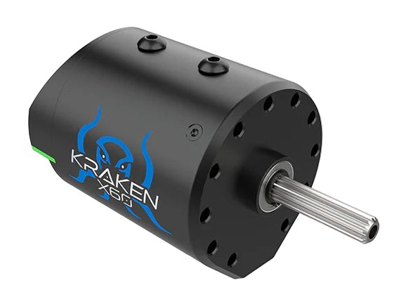
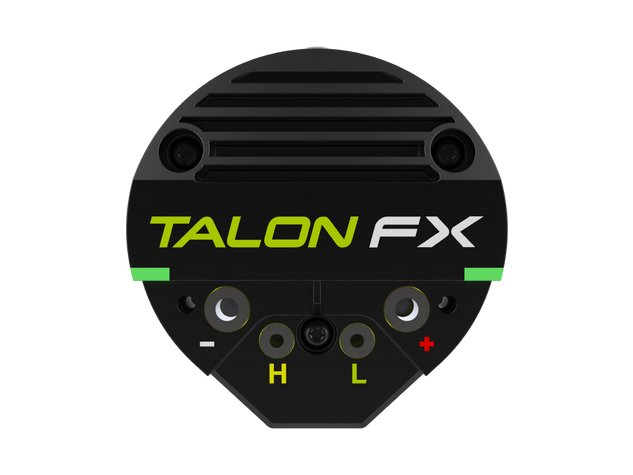
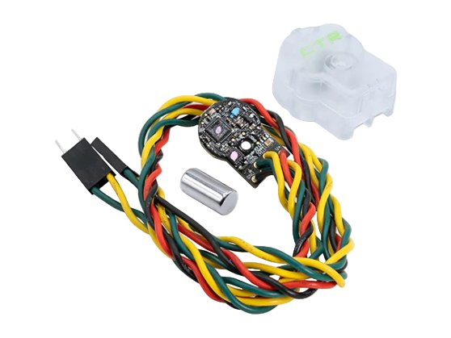
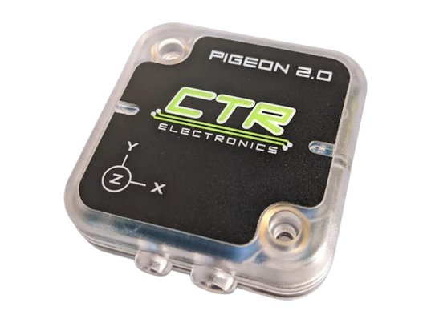
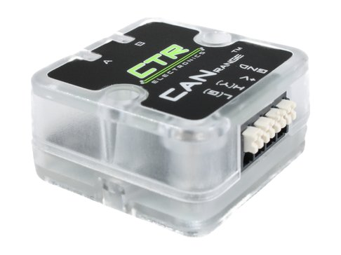
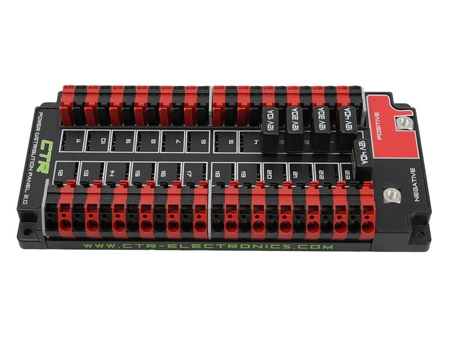
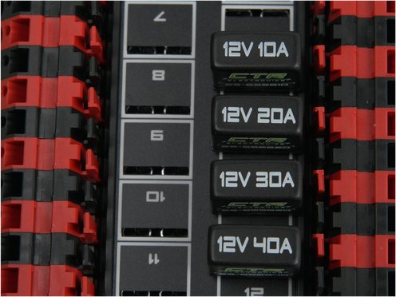
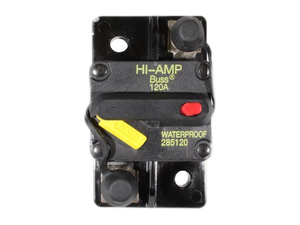
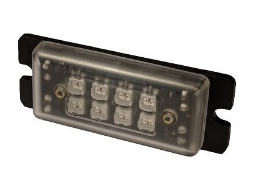

# 常用设备 { #common-devices }

我们大多数机器人都会用到的电机、传感器和供电设备，包括选型和接线时要看的参数，以及它们的状态灯是什么意思。除了断路器和 PDP 2.0，其他都是 CTR Electronics（CTRE）生产的 CAN 设备，用 Phoenix Tuner X 配置，用 Phoenix 6 编程。

## 看懂状态灯 { #reading-the-status-lights }

每个 CTRE 的 CAN 设备都有会闪烁出代码的状态灯。设备不工作时，最先检查的就是它们。本页上的灯和真实设备的闪法一样，大多数设备共用这些代码：

| 灯 | 含义 |
|---|---|
| <i class="led"></i><i class="led"></i> 不亮 | 没有电。检查断路器和红黑线。 |
| <i class="led red-off"></i><i class="led red-off late"></i> 红色 | 没有 CAN：设备收不到 roboRIO 的信号。见[故障排查](../electronics/troubleshooting.md)。 |
| <i class="led orange-off"></i><i class="led orange-off"></i> 橙色 | CAN 正常。机器人处于禁用状态，或者还没有东西在控制这个设备。 |
| <i class="led green-off"></i><i class="led green-off late"></i> 绿色 | CAN 正常，设备正在使用中。 |
| <i class="led red-orange"></i><i class="led red-orange late"></i> 红橙交替 | 硬件损坏。在 Phoenix Tuner X 里运行 Self Test，然后联系 CTRE。 |
| <i class="led orange-green"></i><i class="led"></i> 单灯绿橙交替 | 引导程序（bootloader）模式：设备需要刷固件。在 Phoenix Tuner X 里进行 Field Upgrade。 |

如果灯的闪法和哪个代码都对不上，设备可能在两种代码之间来回切换。最常见的是在有 CAN 和没有 CAN 之间闪烁，说明黄线或绿线松了。

## 电机与控制 { #motors-and-control }

照片：[CTR Electronics](https://store.ctr-electronics.com/products/kraken-x60)
{ .item__credit }

### Kraken X60 { #kraken-x60 }

电机，内置 Talon FX 电机控制器
{ .item__aka }

我们的主力电机，用在底盘、吸取机构、发射机构和升降机构上。电机控制器就是电机的后端，所以一个 Kraken 只需要两组连接：红黑线接到 PDP 2.0，黄绿线接到 CAN 总线。

| | |
|---|---|
| 空载转速 | 6,000 RPM（FOC 模式下 5,800） |
| 堵转扭矩 | 7.09 N·m（FOC 模式下 9.37 N·m） |
| 堵转电流 | 366 A（FOC 模式下 483 A） |
| 空载电流 | 2 A |
| 峰值功率 | 1,108 W（FOC 模式下 1,405 W） |
| 电压 | 6–24 V |
| 重量 | 1.2 lb（0.54 kg） |
| 输出轴 | SplineXS |
| 线缆 | 10 AWG 红黑线，18 in；CAN Y 型线束 |

- **FOC** 是一种驱动电机的方式，牺牲一点最高转速，换来更大的扭矩。需要 Phoenix Pro 授权。
- 用 40 A 断路器。线径见[电源接线](../electronics/power-wiring.md#wire-gauge-awg)。
- **状态灯：**背面的两条灯带，在 TALON FX 标签的两侧。代码见 [Talon FX](#talon-fx)。

[商店页面](https://store.ctr-electronics.com/products/kraken-x60) ·
[文档](https://v6.docs.ctr-electronics.com/en/stable/docs/hardware-reference/talonfx/index.html)

照片：[CTR Electronics](https://store.ctr-electronics.com/products/kraken-x60)
{ .item__credit }

### Talon FX { #talon-fx }

电机控制器，内置在 Kraken X60 里
{ .item__aka }

电机控制器从 CAN 总线上接收 roboRIO 的指令，把电池的电转换成电机需要的功率。在 Kraken X60 里，它内置在电机背面，所以不需要另外安装一个盒子。线用螺丝固定在图中的端子上：**−** 和 **+** 接电源，**H** 和 **L** 接 CAN。

| | |
|---|---|
| 控制方式 | CAN 或 PWM，自动识别 |
| 内置 PID | 在控制器上以 1 kHz 运行 |
| 换相方式 | 梯形换相，或使用 Phoenix Pro 的 FOC |
| 电源端子 | #6-32 梅花螺丝 |
| CAN 端子 | #4-40 梅花螺丝 |
| 软件 | Phoenix 6，用 Phoenix Tuner X 配置 |

状态灯
{ .item__subhead }

=== "机器人禁用时"

    | 灯 | 含义 | 怎么做 |
    |---|---|---|
    | <i class="led"></i><i class="led"></i> 不亮 | 没有电 | 检查断路器和红黑线。 |
    | <i class="led red-off"></i><i class="led red-off late"></i> 红色，交替闪 | 没有 CAN 或 PWM 信号 | 检查黄绿线，并确认 roboRIO 已开机。见[故障排查](../electronics/troubleshooting.md)。 |
    | <i class="led orange-off"></i><i class="led orange-off late"></i> 橙色，交替闪 | CAN 正常，但 roboRIO 上没有运行使用 Phoenix 的代码 | 部署使用 Phoenix 的机器人代码。 |
    | <i class="led orange-off"></i><i class="led orange-off"></i> 橙色，同时闪 | CAN 正常，机器人禁用 | 不用处理：这是正常的。 |

=== "机器人启用时"

    | 灯 | 含义 |
    |---|---|
    | <i class="led orange"></i><i class="led orange"></i> 橙色常亮 | 已启用，但收到的指令是输出 0。如果它应该在动，检查代码是否给它发送了控制请求。 |
    | <i class="led green-off"></i><i class="led green-off"></i> 绿色，同时闪 | 正转。闪得越快，功率越大。 |
    | <i class="led red-off"></i><i class="led red-off"></i> 红色，同时闪 | 反转。闪得越快，功率越大。 |
    | <i class="led red-off"></i><i class="led"></i> 一侧红色 | 停在了正向或反向软限位。 |

=== "故障"

    | 灯 | 含义 | 怎么做 |
    |---|---|---|
    | <i class="led orange-off"></i><i class="led"></i> 一侧橙色 | 过热：已经关断输出降温 | 让它冷却。调低它的定子电流限制。 |
    | <i class="led red-green"></i><i class="led red-green late"></i> 红绿交替 | 代码用了 Phoenix Pro 的功能，但这个电机没有 Pro 授权 | 给电机购买授权，或者不使用这个功能。 |
    | <i class="led red-orange"></i><i class="led red-orange late"></i> 红橙交替 | 硬件损坏 | 在 Phoenix Tuner X 里运行 Self Test，然后联系 CTRE。 |
    | <i class="led orange-green"></i><i class="led"></i> 单灯绿橙交替 | 引导程序模式：需要刷固件 | 在 Phoenix Tuner X 里进行 Field Upgrade。 |

## 传感器 { #sensors }

照片：[CTR Electronics](https://store.ctr-electronics.com/products/cancoder)
{ .item__credit }

### CANcoder { #cancoder }

磁编码器
{ .item__aka }

测量轴的角度。轴的末端装一块小磁铁，在 CANcoder 的芯片上方旋转。它是**绝对式**的：一通电就知道角度，不需要先把轴转到某个起始位置。在舵轮模块上，它告诉机器人轮子朝向哪里。

| | |
|---|---|
| 测量 | 磁铁的位置和速度 |
| 磁场强度 | 45–75 mT 最佳；25 到 135 mT 也能用，但精度较低 |
| 供电 | 6–16 V |
| 电流 | 低于 50 mA（最大 60 mA） |
| CAN | CAN 2.0 和 CAN FD |
| 线缆 | 22 AWG，12 in；CAN 用 3 针接头 |

- 状态灯也会显示磁场强度，所以可以根据颜色来调整磁铁的距离。上电后要等 8 秒它才开始显示。

[商店页面](https://store.ctr-electronics.com/products/cancoder) ·
[文档](https://v6.docs.ctr-electronics.com/en/stable/docs/hardware-reference/cancoder/index.html)

状态灯
{ .item__subhead }

只有一个灯。**亮**表示 CAN 正常。**暗**表示从上电起就没收到过 CAN 信号。颜色表示磁铁的情况。

| 灯 | 含义 | 怎么做 |
|---|---|---|
| <i class="led"></i> 不亮 | 没有电 | 检查红黑线。 |
| <i class="led red-off slow"></i> 红色慢闪 | 没有 CAN | 检查黄绿线，并确认 roboRIO 已开机。 |
| <i class="led green-off fast"></i> 绿色亮，快闪 | CAN 正常，磁铁正常 | 不用处理：这是正常的。 |
| <i class="led orange-off fast"></i> 橙色亮，快闪 | CAN 正常；磁场略弱或略强，精度降低 | 调整磁铁的距离，并让它对准芯片。 |
| <i class="led red-off fast"></i> 红色亮，快闪 | CAN 正常；磁场超出范围（低于 25 或高于 135 mT） | 检查磁铁是否在位、是否对准、距离是否合适。 |
| <i class="led green-off fast dim"></i> 绿色、橙色或红色暗，快闪 | 上电后没收到过 CAN；颜色含义同上，表示磁铁的情况 | 先检查 CAN 线和电源，再检查磁铁。 |
| <i class="led red-orange"></i> 红橙交替 | 硬件损坏 | 在 Phoenix Tuner X 里运行 Self Test，然后联系 CTRE。 |
| <i class="led orange-green"></i> 橙绿交替 | 引导程序模式：需要刷固件 | 在 Phoenix Tuner X 里进行 Field Upgrade。 |

照片：[CTR Electronics](https://store.ctr-electronics.com/products/pigeon-2)
{ .item__credit }

### Pigeon 2.0 { #pigeon-20 }

惯性测量单元（陀螺仪）
{ .item__aka }

测量机器人朝向哪个方向（偏航角，yaw）以及倾斜了多少（俯仰角 pitch 和横滚角 roll）。场地坐标系下的舵轮驾驶就靠它：机器人必须知道场地上哪个方向是前方。

| | |
|---|---|
| 传感器 | 三轴陀螺仪、加速度计和磁力计 |
| 测量 | 偏航、俯仰和横滚 |
| 偏航漂移 | 行驶时每分钟约 0.4° |
| 陀螺仪量程 | 最高每秒 2,000° |
| 加速度计 | ±8 g |
| 供电 | 6–28 V，约 40 mA |
| CAN | CAN 2.0 和 CAN FD |
| 线缆 | 一组电源线，两组 CAN 线（进和出） |
| 重量 | 30 g |

- **开机后让机器人保持静止 4 秒。**如果马上移动，漂移会增加一倍以上（每分钟约 1°）。
- 可以平放、侧放或斜着安装。位置定下来以后，在 Phoenix Tuner X 里运行安装校准。

[商店页面](https://store.ctr-electronics.com/products/pigeon-2) ·
[文档](https://v6.docs.ctr-electronics.com/en/stable/docs/hardware-reference/pigeon2/index.html)

状态灯
{ .item__subhead }

| 灯 | 含义 | 怎么做 |
|---|---|---|
| <i class="led"></i><i class="led"></i> 不亮 | 没有电 | 检查红黑线。 |
| <i class="led red-off"></i><i class="led red-off late"></i> 红色，交替闪 | 没有 CAN | 检查黄绿线，并确认 roboRIO 已开机。 |
| <i class="led orange-off"></i><i class="led orange-off late"></i> 橙色，交替闪 | CAN 正常，但 roboRIO 上没有运行使用 Phoenix 的代码 | 部署使用 Phoenix 的机器人代码。 |
| <i class="led orange-off"></i><i class="led orange-off"></i> 橙色，同时闪 | CAN 正常，机器人禁用 | 不用处理：这是正常的。 |
| <i class="led green-off"></i><i class="led green-off late"></i> 绿色，交替闪 | CAN 正常，机器人启用 | 不用处理：这是正常的。 |
| <i class="led red-orange"></i><i class="led red-orange late"></i> 红橙交替 | 硬件损坏 | 在 Phoenix Tuner X 里运行 Self Test，然后联系 CTRE。 |
| <i class="led orange-green"></i><i class="led"></i> 单灯绿橙交替 | 引导程序模式：需要刷固件 | 在 Phoenix Tuner X 里进行 Field Upgrade。 |

照片：[CTR Electronics](https://store.ctr-electronics.com/products/canrange)
{ .item__credit }

### CANrange { #canrange }

距离传感器（飞行时间，ToF）
{ .item__aka }

通过测量一束激光脉冲反射回来所用的时间来测距离。可以用它判断吸取机构里有没有游戏道具，或者墙有多远。它也可以当作光电门或限位开关来用：设定一个距离，它就会报告有没有东西比这个距离更近。

| | |
|---|---|
| 量程 | 1 cm 到 3 m（远距离模式），最远 1 m（近距离模式） |
| 分辨率 | 1 mm |
| 刷新率 | 近距离模式最高 100 Hz，其他模式 50 Hz |
| 激光 | 1 类，对人眼安全 |
| 供电 | 12 V |
| 保护 | 防反接，静电防护达 30 kV |

[商店页面](https://store.ctr-electronics.com/products/canrange) ·
[文档](https://v6.docs.ctr-electronics.com/en/stable/docs/hardware-reference/canrange/index.html)

状态灯
{ .item__subhead }

CAN 正常时，颜色表示检测距离内有没有东西，闪烁快慢大致表示它有多远。

| 灯 | 含义 | 怎么做 |
|---|---|---|
| <i class="led"></i><i class="led"></i> 不亮 | 没有电 | 检查电源线。 |
| <i class="led red-off"></i><i class="led red-off late"></i> 红色，交替闪 | 没有 CAN | 检查黄绿线，并确认 roboRIO 已开机。 |
| <i class="led orange-off"></i><i class="led orange-off late"></i> 橙色，交替闪 | CAN 正常；检测距离内没有东西 | 不用处理：这是正常的。 |
| <i class="led green-off"></i><i class="led green-off late"></i> 绿色，交替闪 | CAN 正常；检测距离内有东西 | 不用处理：这是正常的。 |
| <i class="led red-orange"></i><i class="led red-orange late"></i> 红橙交替 | 硬件损坏 | 在 Phoenix Tuner X 里运行 Self Test，然后联系 CTRE。 |
| <i class="led orange-green"></i><i class="led"></i> 单灯绿橙交替 | 引导程序模式：需要刷固件 | 在 Phoenix Tuner X 里进行 Field Upgrade。 |

## 供电 { #power }

照片：[CTR Electronics](https://store.ctr-electronics.com/products/pdp-2)
{ .item__credit }

### PDP 2.0 { #pdp-20 }

电源分配板
{ .item__aka }

电池的电经过主断路器进入 PDP 2.0，再分成 24 个通道，每个通道都有自己的断路器。和初代 PDP 以及 REV 的 PDH 不同，它里面没有电子电路：没有 CAN、不能测电流，也没有状态灯。电流改由电机控制器自己测量。

| | |
|---|---|
| 通道 | 24 个，每个最大 40 A |
| 断路器 | ATO 规格的断路器或保险丝 |
| 输入 | 4 或 6 AWG，接在两个 M6 螺栓上 |
| 输入螺栓扭矩 | 2.5 N·m，不能更大 |
| 输出 | WAGO 杠杆式夹线端子，22–10 AWG |
| 剥线长度 | 3/8 in（约 10 mm） |
| 尺寸 | 9.21 × 4.08 × 1.40 in（装上断路器高 1.70 in） |
| 重量 | 1.20 lb，不含断路器和线 |

- 每个输入螺栓下面都垫上弹簧垫圈，防止震动让它松掉。
- 打开夹线端子时，把 PDP 专用的 WAGO 工具或一字螺丝刀插进上面的槽里，往板子方向撬。把线插进去，松手，再拽一下确认。
- 因为没有 CAN，它不能像 PDH 那样作为 CAN 总线的末端。总线末端要接一个 120 Ω 电阻。

[商店页面](https://store.ctr-electronics.com/products/pdp-2) ·
[用户手册](https://ctre.download/files/user-manual/PDP%202.0%20User's%20Guide.pdf)

没有状态灯
{ .item__subhead }

PDP 2.0 自己不能告诉你任何信息，所以要通过接在通道上的设备来检查：

- **设备的灯不亮：**检查断路器是否完全插进了槽里，两个 WAGO 夹线端子是否都夹住了线。
- **还是不亮：**机器人开机，把万用表调到直流电压档，表笔分别接触这个通道的 + 和 − 夹线端子。读数应该是电池电压，约 12 V。如果是，问题就出在通往设备的线上。

照片：[CTR Electronics](https://store.ctr-electronics.com/products/auto-resetting-ato-breakers)
{ .item__credit }

### 断路器 { #circuit-breakers }

自恢复 ATO 断路器
{ .item__aka }

PDP 2.0 的每个通道都有一个断路器，在电流过大、导线过热之前切断电源。这些断路器会自己恢复：断路器冷却后，电就会重新接通。

| | |
|---|---|
| 额定电流 | 10、20、30 和 40 A，印在顶部 |
| 尺寸 | ATO：可插入 PDP 2.0 的任意槽位 |
| 跳闸 | 电流持续超过额定值时 |
| 复位 | 冷却后自动复位 |

- 先根据设备选断路器，再根据断路器选线。线径见[电源接线](../electronics/power-wiring.md#wire-gauge-awg)。
- 常用规格：Kraken X60 用 40 A，roboRIO 或无线网桥用 10 A。

[商店页面](https://store.ctr-electronics.com/products/auto-resetting-ato-breakers)

没有状态灯
{ .item__subhead }

断路器跳闸会表现在设备上：设备在大负载下断电，灯灭掉，几秒后又亮起来。如果反复出现这种情况，说明机构负载过大。检查有没有卡住或堵转的地方，或者调低电机的电流限制。

照片：[CTR Electronics](https://store.ctr-electronics.com/products/120-amp-breaker)
{ .item__credit }

### 主断路器 { #main-breaker }

120 A 断路器
{ .item__aka }

机器人的电源开关，也是整台机器人的断路器。电池的所有电都要经过它才能到达 PDP 2.0。

| | |
|---|---|
| 额定电流 | 120 A |
| 型号 | Bussmann CB285-120 |
| 端子 | M6 螺柱，配 1/4 in 环形铜鼻子 |
| 最高电压 | 48 V DC |
| 复位 | 手动 |

- 接线方法：[电池到 PDH/PDP](../electronics/power-wiring.md#battery-to-pdhpdp)。

[商店页面](https://store.ctr-electronics.com/products/120-amp-breaker)

没有状态灯：看拨杆
{ .item__subhead }

| 拨杆 | 含义 |
|---|---|
| 按进去 | 开 |
| 弹出来，像照片里那样 | 关，或者已跳闸 |

- **开机：**把黄色拨杆按进去，直到听见咔哒一声。
- **关机：**按下红色按钮，拨杆会弹出来。
- 如果它自己跳闸了，说明整台机器人在较长时间内的电流超过了 120 A。检查电机的电流限制。

## 其他 { #miscellaneous }

照片：[CTR Electronics](https://store.ctr-electronics.com/products/candle)
{ .item__credit }

### CANdle { #candle }

LED 控制器和 5 V 稳压器
{ .item__aka }

通过 CAN 总线控制可编程 RGB LED 灯带，让机器人代码可以点亮机器人：比如告诉操作团队机器人已经拿到了游戏道具。它顶部自带 8 颗 RGB LED，5 V 输出可以给灯带供电。

| | |
|---|---|
| 输入 | 6–28 V |
| 输出 | 5 V，最大 6 A |
| 板载 LED | 8 颗 RGB |
| LED 灯带 | WS2812B 型（可编程） |
| 线缆 | CAN 用 22 AWG，电源用 18 AWG |
| 保护 | 短路、过流和过热保护 |

[商店页面](https://store.ctr-electronics.com/products/candle) ·
[文档](https://v6.docs.ctr-electronics.com/en/stable/docs/hardware-reference/candle/index.html)

状态灯
{ .item__subhead }

| 灯 | 含义 | 怎么做 |
|---|---|---|
| <i class="led"></i> 不亮 | 没有电，或者在配置里关掉了状态灯 | 检查红黑线。 |
| <i class="led red-off"></i> 红色闪烁 | 没有 CAN，也没有 LED 信号 | 检查黄绿线，并确认 roboRIO 已开机。 |
| <i class="led orange-off"></i> 橙色闪烁 | CAN 正常，但没有东西在控制它 | 检查代码是否在给它发送指令。 |
| <i class="led green-off"></i> 绿色闪烁 | CAN 正常，并且正在被控制 | 不用处理：这是正常的。 |
| <i class="led red-off fast"></i> 红色快闪 | 5 V 输出电压过高 | 检查 V+ 输出和 5 V 输出之间有没有短路。 |
| <i class="led red-off blip"></i> 红色短闪 | 短路，或者它自己切断了输出（软件保险） | 在 Phoenix Tuner X 里查看故障，检查有没有短路，并减少供电的 LED 数量。 |
| <i class="led orange-off blip"></i> 橙色短闪 | 过热 | 让它冷却，关掉板载 LED，或者减少供电的 LED 数量。 |
| <i class="led red-orange"></i> 红橙交替 | 硬件损坏 | 在 Phoenix Tuner X 里运行 Self Test，然后联系 CTRE。 |
| <i class="led orange-green"></i> 橙绿交替 | 引导程序模式：需要刷固件 | 在 Phoenix Tuner X 里进行 Field Upgrade。 |

??? note "资料来源和照片版权"

    参数来自每个设备在 CTR Electronics 的商店页面和用户手册，状态灯代码来自 CTRE 的 [Phoenix 6 硬件参考](https://v6.docs.ctr-electronics.com/en/stable/docs/hardware-reference/index.html)。如果有对不上的地方，请以那里为准：固件更新可能会改变它们。

    所有产品照片均由 CTR Electronics 拍摄，来自他们的商店页面，版权归他们所有。
