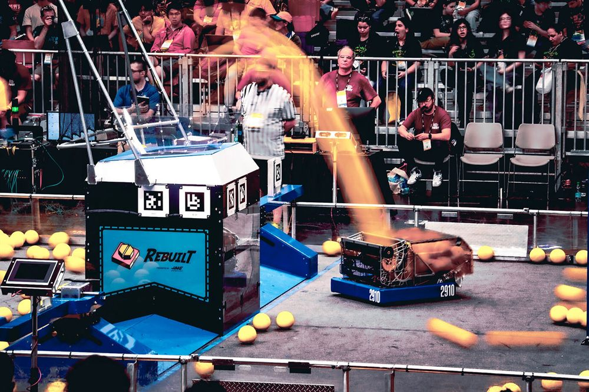
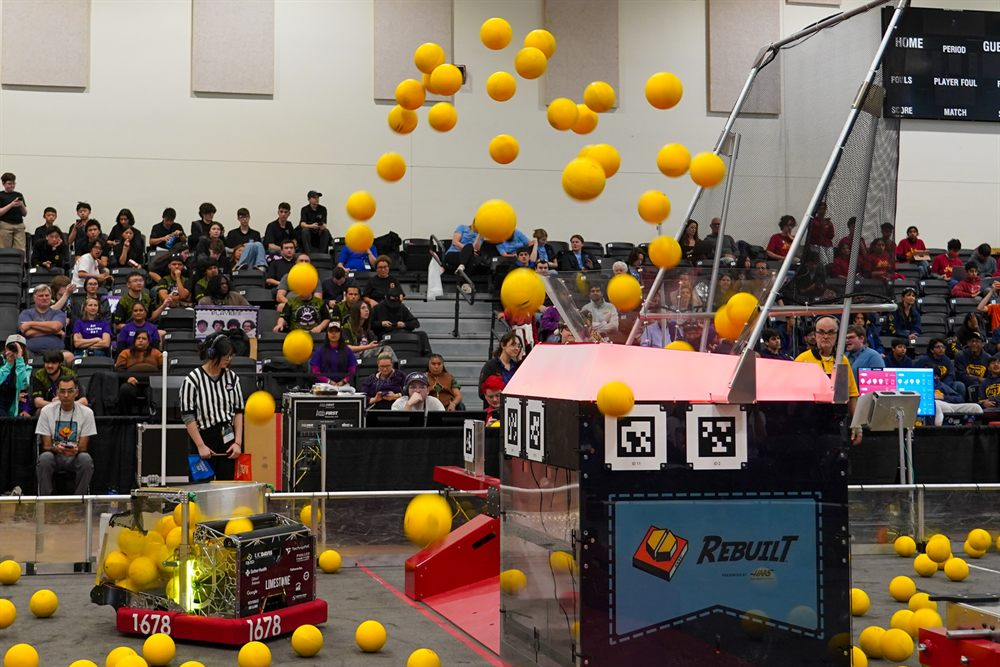
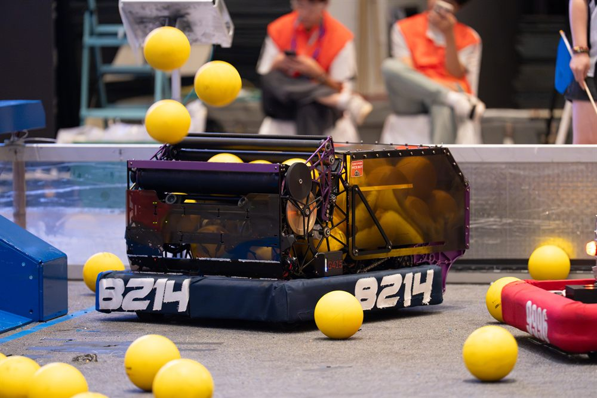

# Command-based styles

Command-based gives every team the same pieces: subsystems, commands and
triggers. How a team puts them together is up to them, and different teams
build their robot code in very different ways. This page looks at the
structures used by some of the best teams in FRC.

Photo: Team 2910, via [Chief Delphi](https://www.chiefdelphi.com/t/2910-cad-and-tech-binder-release-2026/521705/1)
{ .item__credit }

## Team 2910

Jack in the Bot · Re•Blitz, their 2026 robot
{ .item__aka }

Every subsystem is a state machine, built on shared roller and servo base
classes. Buttons only set the state the robot should be in, and a
SuperStructure coordinates the rest. Their code is on GitHub at
[FRCTeam2910/2026CompetitionRobot-Public](https://github.com/FRCTeam2910/2026CompetitionRobot-Public).

[:octicons-arrow-right-24: Team 2910's code](team-2910.md)

Photo: Team 1678, from their [README](https://github.com/frc1678/C2026-Public)
{ .item__credit }

## Team 1678

Citrus Circuits · Limestone, their 2026 robot
{ .item__aka }

Usual command-based code, built up to a whole robot. Each subsystem is one
motor or motor group that takes a setpoint, on bases with one shared
parent, and a Superstructure full of commands combines them. Their code is
on GitHub at
[frc1678/C2026-Public](https://github.com/frc1678/C2026-Public).

[:octicons-arrow-right-24: Team 1678's code](team-1678.md)

Photo: Team 8214, from their [README](https://github.com/nirobotics/ni-8214-2026-public)
{ .item__credit }

## Team 8214

Cyber Unicorn · MACK, their 2026 offseason robot
{ .item__aka }

Coming soon. Their code is on GitHub at
[nirobotics/ni-8214-2026-public](https://github.com/nirobotics/ni-8214-2026-public).

??? info "Photo credits"

    - **Re•Blitz, Team 2910:** from Team 2910's
      [CAD and Tech Binder Release 2026](https://www.chiefdelphi.com/t/2910-cad-and-tech-binder-release-2026/521705/1)
      on Chief Delphi, posted by Kylie_Liu
    - **Limestone, Team 1678:** from the README of Team 1678's
      [C2026-Public](https://github.com/frc1678/C2026-Public) repository on
      GitHub
    - **MACK, Team 8214:** from the README of Team 8214's
      [ni-8214-2026-public](https://github.com/nirobotics/ni-8214-2026-public)
      repository on GitHub

    The photos belong to the teams. They're shown here, made smaller, only
    to introduce each team's code. To have a photo changed or removed,
    [open an issue](https://github.com/927-927/927-927.github.io/issues) on
    this site's repository.
