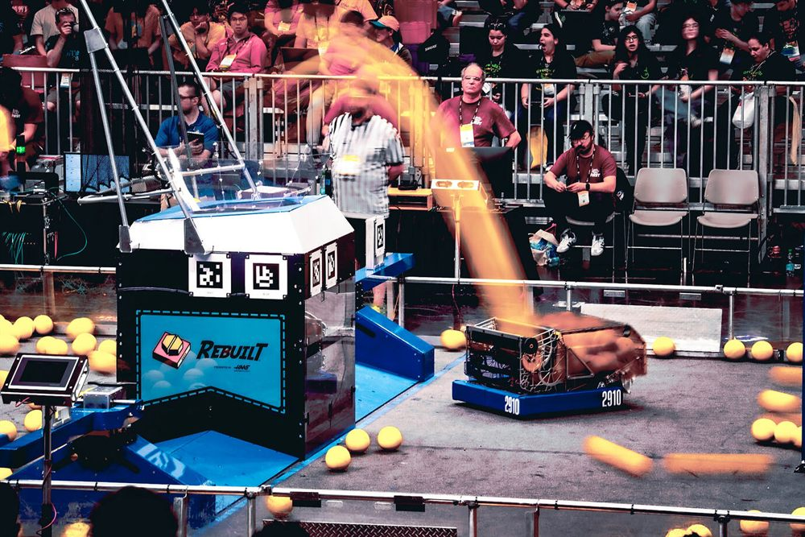
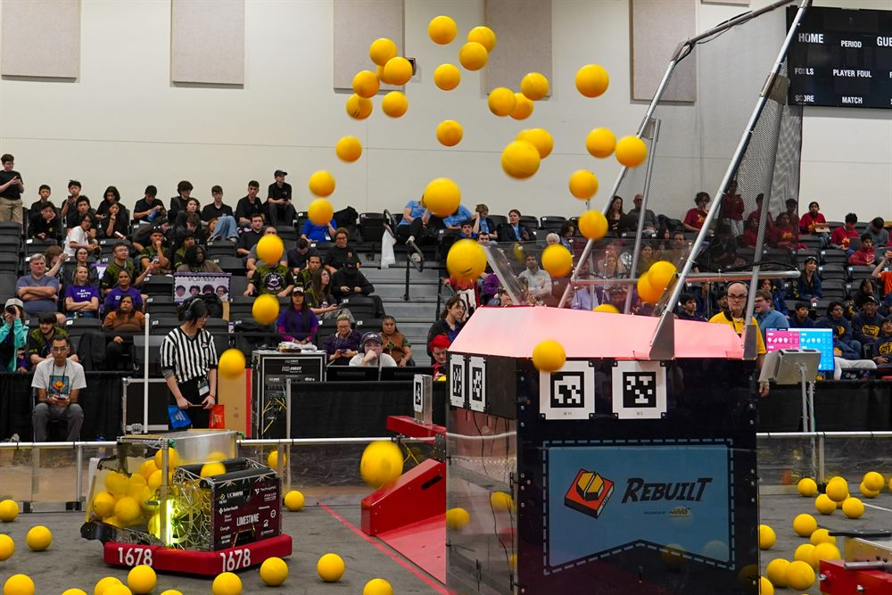
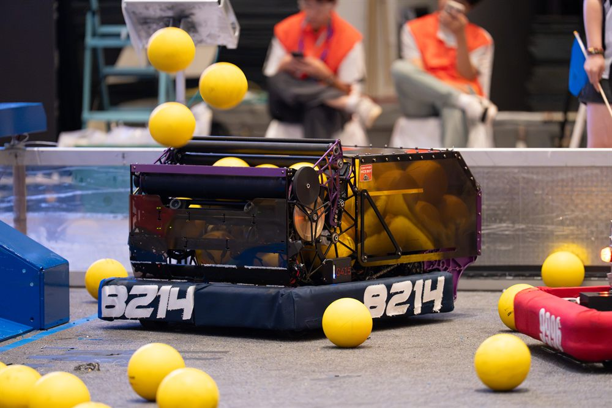

# 各队的基于命令风格 { #command-based-styles }

基于命令给每支队伍提供了同样的组件：子系统、命令和触发器。至于怎样把它们组合起来，由各队自己决定，不同的队伍搭建机器人代码的方式差别很大。这一页介绍 FRC 里一些顶尖队伍使用的代码结构。

照片：2910 队，来自 [Chief Delphi](https://www.chiefdelphi.com/t/2910-cad-and-tech-binder-release-2026/521705/1)
{ .item__credit }

## 2910 队 { #team-2910 }

Jack in the Bot · Re•Blitz，他们 2026 年的机器人
{ .item__aka }

每个子系统都是一个状态机，建立在共用的滚轮（roller）和伺服（servo）基类之上。按钮只设置机器人应该处于的状态，其余的由一个 SuperStructure 来协调。他们的代码在 GitHub 上：[FRCTeam2910/2026CompetitionRobot-Public](https://github.com/FRCTeam2910/2026CompetitionRobot-Public)。

[:octicons-arrow-right-24: 2910 队的代码](team-2910.md)

照片：1678 队，来自他们的 [README](https://github.com/frc1678/C2026-Public)
{ .item__credit }

## 1678 队 { #team-1678 }

Citrus Circuits · Limestone，他们 2026 年的机器人
{ .item__aka }

常规的基于命令代码，一直搭建到整台机器人。每个子系统是一个接收设定值的电机或电机组，建立在共用同一个父类的基类之上，再由一个装满命令的 Superstructure 把它们组合起来。他们的代码在 GitHub 上：[frc1678/C2026-Public](https://github.com/frc1678/C2026-Public)。

[:octicons-arrow-right-24: 1678 队的代码](team-1678.md)

照片：8214 队，来自他们的 [README](https://github.com/nirobotics/ni-8214-2026-public)
{ .item__credit }

## 8214 队 { #team-8214 }

Cyber Unicorn · MACK，他们 2026 年休赛期的机器人
{ .item__aka }

即将推出。他们的代码在 GitHub 上：[nirobotics/ni-8214-2026-public](https://github.com/nirobotics/ni-8214-2026-public)。

??? info "照片版权"

    - **Re•Blitz，2910 队：**来自 2910 队在 Chief Delphi 上发布的 [CAD and Tech Binder Release 2026](https://www.chiefdelphi.com/t/2910-cad-and-tech-binder-release-2026/521705/1)，发帖人 Kylie_Liu
    - **Limestone，1678 队：**来自 1678 队 GitHub 仓库 [C2026-Public](https://github.com/frc1678/C2026-Public) 的 README
    - **MACK，8214 队：**来自 8214 队 GitHub 仓库 [ni-8214-2026-public](https://github.com/nirobotics/ni-8214-2026-public) 的 README

    照片版权归各队所有。这里缩小展示，只用于介绍各队的代码。如需更换或删除照片，请在本站的仓库[提交 issue](https://github.com/927-927/927-927.github.io/issues)。
