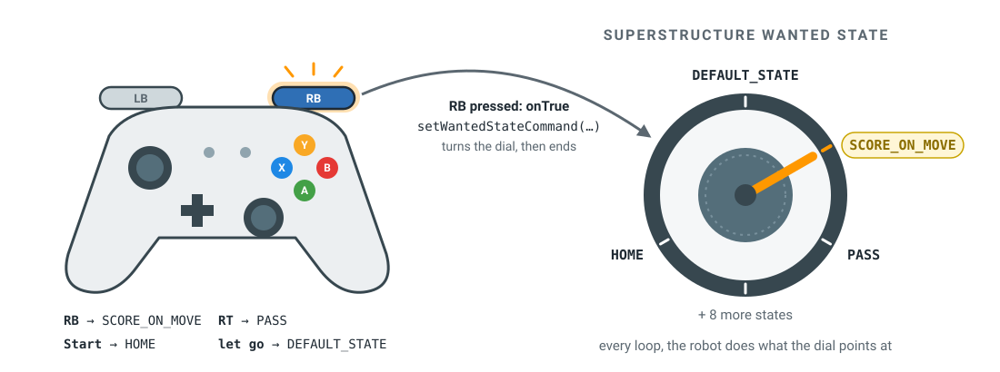
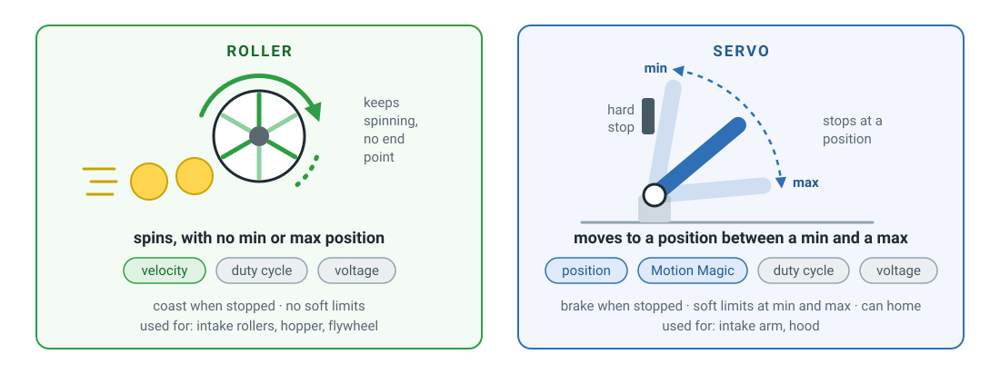
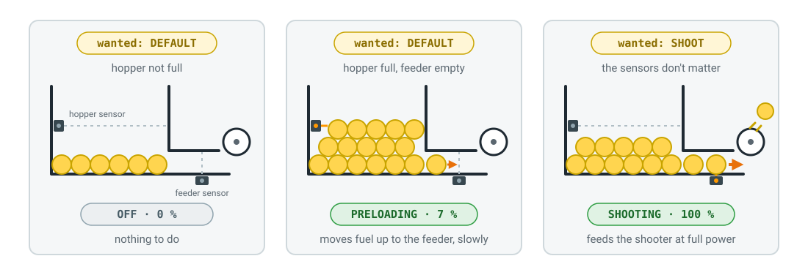
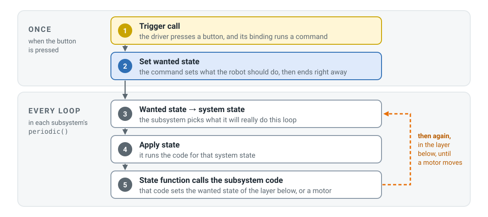

# 2910 队 { #team-2910 }

2910 队用的是基于命令的代码，但他们的命令几乎都不直接驱动电机。每个子系统都是一个**状态机**，按下按钮只是告诉机器人你想要哪个状态。剩下的事情，机器人每次循环都会自己算出来。

<figure class="diagram" markdown="span">
  [](../../assets/images/software/team-2910-dial.svg)
  <figcaption>
    按钮只负责拨动旋钮。每次循环，机器人都去做旋钮指着的事。
  </figcaption>
</figure>

这一页看他们 2026 年（比赛项目 REBUILT）代码里的两件事：子系统是怎样组织的，以及一个命令是怎样从按钮一路传到电机的。

!!! info "关于本页的代码"

    代码节选自 2910 队 2026 年的机器人代码，GitHub 上的 [FRCTeam2910/2026CompetitionRobot-Public](https://github.com/FRCTeam2910/2026CompetitionRobot-Public)。省略了日志、仿真和大部分常量，一些长行做了换行或拆分以便显示，注释翻译成了中文。

    Copyright (c) 2026 FIRST Robotics Team 2910，以 [MIT 许可证](https://github.com/FRCTeam2910/2026CompetitionRobot-Public/blob/main/LICENSE)共享。

## 子系统是怎样组织的 { #how-the-subsystems-are-organized }

### 子系统基类 { #subsystem-bases }

2910 只把电机代码写一次，作为 `subsystems/base` 里的基类，每个真正的子系统都 `extends` 其中一个。每种机构对应一个基类，这些基类之间没有共同的父类。

#### 子系统下面的各层 { #the-layers-under-a-subsystem }

基类是从机器人子系统到电机的五层之一，每一层只和它下面的那一层打交道：

<figure class="diagram" markdown="span">
  [![从上到下共五层。第 1 层，机器人子系统，也就是状态机：HopperSubsystem 和 FlywheelSubsystem 继承 roller，IntakeSubsystem 和 HoodSubsystem 继承 servo。第 2 层，subsystems/base 里的基类：RollerMotorSubsystem 及其 WithFollowers 版本，ServoMotorSubsystem 及其 WithFollowers 和 WithFusedCanCoder 版本。两者都继承 SubsystemBase，没有共同的父类，所以占空比、电压和空闲模式在两边都写了一遍。每个都持有自己的 io。第 3 层，MotorIO，一个接口，包含 setOpenLoopDutyCycle、setVoltageOutput 和 setMotionMagicSetpoint 等方法。第 4 层，IO 实现：机器人上用 MotorIOTalonFX，仿真时用继承它的 SimMotorIOTalonFX。RobotContainer 用 RobotBase.isSimulation 选择其中一个。第 5 层，硬件：TalonFX，或者物理模型 DCMotorSim。右侧是调角板的一次调用逐层向下：HoodSubsystem 调用 setMotionMagicSetpoint(desiredHoodAngle)，ServoMotorSubsystem 记录日志并调用 io.setMotionMagicSetpoint，MotorIO 只声明这个方法，MotorIOTalonFX 用一个 Motion Magic 请求调用 talon.setControl，电机把调角板转到这个角度](../../assets/images/software/team-2910-layers.svg)](../../assets/images/software/team-2910-layers.svg)
  <figcaption>
    右侧是调角板的一次调用，一层一层往下走。
  </figcaption>
</figure>

- **机器人子系统**决定要做什么，但从不直接碰电机。`HoodSubsystem` 调用 `setMotionMagicSetpoint()`，这是它从伺服基类继承来的方法。
- **基类**存放每种机构的电机代码。它们记录请求，然后把请求传给 `io`。
- **`MotorIO`** 是一个接口：列出电机可以被要求做的事情，但没有任何真正运行电机的代码。
- **IO 实现**做真正的工作。`MotorIOTalonFX` 把请求发给 TalonFX。`SimMotorIOTalonFX` 继承它，但把大部分请求改发给物理模型 `DCMotorSim`。`RobotContainer` 在构建每个子系统时选择其中一个，所以同一份子系统代码既能在机器人上运行，也能在仿真中运行。

滚轮基类和伺服基类是**兄弟关系**。它们各自继承 `SubsystemBase`，各自持有自己的 `io`，之间没有共同的父类。所以两者都需要的 setter，比如 `setOpenLoopDutyCycle()`、`setVoltageOutput()` 和 `setNeutralMode()`，被写了两遍，每个文件里一遍。

#### 基类的种类 { #the-kinds-of-base }

机器人上几乎每个机构要么是**旋转**的（吸取滚轮、飞轮），要么是**移动到某个位置**的（臂、调角板），2910 给每种都准备了一个基类：

<figure class="diagram" markdown="span">
  [](../../assets/images/software/team-2910-roller-servo.svg)
  <figcaption>
    灰色的控制模式两个基类都有。
  </figcaption>
</figure>

| | 滚轮（roller） | 伺服（servo） |
|---|---|---|
| **类** | `RollerMotorSubsystem` | `ServoMotorSubsystem` |
| **控制模式** | 速度、占空比、电压 | 位置、Motion Magic、占空比、电压 |
| **空闲模式**（默认） | 滑行（coast） | 刹车（brake） |
| **软限位** | 关 | 开，在最小和最大位置 |
| **归零**（找到零点位置） | 无 | `home()` |
| **Getter** | 速度 | 位置 |

各控制模式的含义：

- **占空比**（duty cycle）：电池电压的一个百分比。`0.5` 就是一半功率。
- **电压**（voltage）：设定的伏数，所以电池电量下降时电机的表现不变。
- **速度**（velocity）：一个目标速度。TalonFX 会调整功率来保持它。
- **位置**（position）：一个目标位置。TalonFX 驱动到那里并保持住。
- **Motion Magic**：也是一个位置目标，但 TalonFX 在途中会加速、匀速、减速，而不是全功率猛冲过去。这是 CTRE 用来让臂和升降机构平稳运动的功能。

每种控制模式都是基类上一个独立的方法，所以选方法就是选模式：滚轮上用 `setMechanismVelocityPerSecondSetpoint()`，伺服上用 `setMotionMagicSetpoint()`。

每个基类还有一个**带从动电机**（with followers）的版本（`RollerWithFollowersSubsystem`、`ServoWithFollowersSubsystem`），用于多个电机驱动同一个关节的情况：一个电机领头，其他电机跟随它。飞轮用的就是这种。

点开这两个文件看看。先从 `RollerMotorSubsystem.java` 开始：

<div class="vscode vscode--wide" markdown>
<div class="vscode__titlebar">2910 子系统基类</div>
<div class="vscode__body" markdown>
<nav class="vscode__sidebar" aria-label="文件">
<div class="vscode__heading">资源管理器</div>
<div class="vscode__folder" style="--depth: 0">subsystems/base</div>
<div class="vscode__folder" style="--depth: 1">roller</div>
<button type="button" class="vscode__file is-active" style="--depth: 2" data-file="roller">RollerMotorSubsystem.java</button>
<div class="vscode__folder" style="--depth: 1">servo</div>
<button type="button" class="vscode__file" style="--depth: 2" data-file="servo">ServoMotorSubsystem.java</button>
</nav>
<div class="vscode__editor" markdown>
<div class="vscode__tabs"><span class="vscode__tab"></span></div>
<div class="vscode__crumbs"></div>
<div class="vscode__panes" markdown>
<div class="vscode__pane" data-file="roller" data-path="src/main/java/org/frc2910/robot/subsystems/base/roller/RollerMotorSubsystem.java" markdown>

```java linenums="1"
public class RollerMotorSubsystem extends SubsystemBase {
    private final MotorIO io;
    private final MotorIOInputsAutoLogged inputs;

    public RollerMotorSubsystem(
            RobotState robotState,
            ConditionalCallbackManager callbackManager,
            MotorIO io) {
        super(io.getConfig().getMotorName());
        this.io = io;
        this.inputs = new MotorIOInputsAutoLogged();
    }

    @Override
    public void periodic() {
        io.updateInputs(inputs);
    }

    public void setOpenLoopDutyCycle(double dutyCycle) {
        io.setOpenLoopDutyCycle(dutyCycle);
    }

    public void setVoltageOutput(double voltage) {
        io.setVoltageOutput(voltage);
    }

    public void setMechanismVelocityPerSecondSetpoint(
            double velocityPerSecond) {
        io.setMechanismVelocityPerSecondSetpoint(
                velocityPerSecond, 0);
    }

    public void setNeutralMode(NeutralModeValue mode) {
        io.setNeutralMode(mode);
    }

    public double getCurrentMechanismVelocityPerSecond() {
        return inputs.mechanismVelocityPerSecondInMechanismUnits;
    }
}
```

<div class="vscode__note" markdown>
**滚轮基类。**`periodic()` 每次循环读取电机的传感器，每个 setter 通过 `io` 把请求传给电机。真实的文件还会给每次调用记录日志，这样队伍可以在日志里清楚地看到代码让电机做了什么。
</div>
</div>
<div class="vscode__pane" data-file="servo" data-path="src/main/java/org/frc2910/robot/subsystems/base/servo/ServoMotorSubsystem.java" markdown>

```java linenums="1"
public class ServoMotorSubsystem extends SubsystemBase {
    private final MotorIO io;
    private final MotorIOInputsAutoLogged inputs;

    // 未展示：构造函数、periodic()、和滚轮一样的
    // setter（占空比、电压、空闲模式）以及 home()

    public void setMechanismPositionSetpoint(
            double mechanismPosition) {
        io.setMechanismPositionSetpoint(mechanismPosition, 0);
    }

    public void setMotionMagicSetpoint(double mechanismPosition) {
        io.setMotionMagicSetpoint(mechanismPosition, 0);
    }

    public double getCurrentMechanismRawPosition() {
        return inputs.mechanismRawPositionInMechanismUnits;
    }
}
```

<div class="vscode__note" markdown>
**伺服基类。**思路和滚轮一样，只是把速度 setter 换成了位置 setter，getter 返回的是位置。
</div>
</div>
</div>
</div>
</div>
</div>

### 创建子系统 { #creating-a-subsystem }

`RobotContainer` 在机器人启动时构建每一个子系统，并传入每个子系统需要的东西：

- **每个子系统一个构建方法**，比如 `buildShooterSubsystem()`。它创建子系统的 IO：如果 `RobotBase.isSimulation()` 就用 `SimMotorIOTalonFX`，否则用 `MotorIOTalonFX`。
- **配置集中在一个地方。**`RobotIdentity` 根据 roboRIO 的序列号判断代码运行在哪台机器人上，`RobotConfiguration` 返回那台机器人的配置。Re•Blitz 的配置是 `ReBlitz.java`，里面有每个电机的 CAN ID、传动比、PID 和限位。`MotorIOTalonFX` 在创建时把电机的配置应用到 TalonFX 上。
- **共享的对象也会传进去**，比如 `RobotState`，它保存着机器人的位姿和速度。
- **有多个电机的子系统自己构建其余的电机。**`IntakeSubsystem` 拿到三个 IO。它用 `super(...)` 把臂的 IO 传给伺服基类，再给每个滚轮创建一个 `RollerMotorSubsystem`。`ShooterSubsystem` 也用同样的方式构建它的 `HoodSubsystem` 和 `FlywheelSubsystem`。
- **顺序很重要。**舵轮最先构建，这样在其他子系统运行之前，机器人的位姿就已经更新了。SuperStructure 最后构建，用的是 `new SuperStructure(this)`，它从 container 里拿到其他子系统。

没有任何全局变量：代码只能访问传给它的子系统。

### 定义子系统 { #defining-subsystems }

真正的子系统用两种方式基于这些基类搭建起来。

<figure class="diagram" markdown="span">
  [](../../assets/images/software/team-2910-structure.svg)
  <figcaption>
    每个箭头都是一次 <code>setWantedState()</code> 调用，所以指令只会向下传。
  </figcaption>
</figure>

**简单的子系统就是一个文件。**它继承主电机对应的基类，把其他电机作为字段。吸取机构的臂是一个伺服，两个滚轮是字段；料仓是四个滚轮：

```java
public class IntakeSubsystem extends ServoMotorSubsystem {
    private final RollerMotorSubsystem rightRoller;
    private final RollerMotorSubsystem leftRoller;
```

```java
public class HopperSubsystem extends RollerMotorSubsystem {
    private final RollerMotorSubsystem rightFrontHopperMotor;
    private final RollerMotorSubsystem rightBackHopperMotor;
    private final RollerMotorSubsystem leftBackHopperMotor;
```

**复杂的子系统先拆开，再组合。**发射机构有一个要转到某个角度的调角板（hood）和一个要旋转的飞轮，它们各自需要自己的逻辑。所以每个都有自己的文件，基于各自的基类，再由 `ShooterSubsystem` 把它们组合成你会指着说"这是发射机构"的那个部分：

```java
public class HoodSubsystem extends ServoMotorSubsystem { ... }

public class FlywheelSubsystem extends RollerWithFollowersSubsystem { ... }

public class ShooterSubsystem extends SubsystemBase {
    private final HoodSubsystem hood;
    private final FlywheelSubsystem flywheels;
```

`ShooterSubsystem` 自己没有电机。调角板和飞轮的 `setWantedState()` 没有加 `public`，所以只有同一个包里的代码，也就是 `ShooterSubsystem`，才能调用它们。机器人上的其他代码都不能绕过发射机构去移动调角板。

最上面是 **SuperStructure**（上层结构）。它也是一个子系统，但没有电机：它的工作是协调吸取机构、料仓、发射机构和舵轮。

### 子系统怎样驱动电机 { #how-a-subsystem-drives-its-motor }

每个子系统都是一个**状态机**。从 SuperStructure 到调角板，每一层的工作方式都一样。它有两个枚举：

- **`WantedState`**（期望状态）：上一层要求的状态。它是一个变量，只有在有人调用 `setWantedState()` 时才会改变。
- **`SystemState`**（系统状态）：子系统这一次循环实际在做的事情。SuperStructure 把自己的这个枚举叫作 `CurrentState`。

每次循环，`periodic()` 做两步：

1.  **`handleStateTransition()`** 根据期望状态和其他相关因素（比如传感器）选出系统状态。
2.  **`applyStates()`** 执行这个系统状态需要做的事：设置一个电机，或者设置下一层的期望状态。

通常系统状态就是跟着期望状态走，但也不总是这样。吸取机构和调角板在归零完成之前会一直保持 `HOMING`，不管期望的是什么。料仓是最清楚的例子：在同一个期望状态下，它的两个距离传感器会选出不同的系统状态。

<figure class="diagram" markdown="span">
  [](../../assets/images/software/team-2910-hopper.svg)
  <figcaption>
    示意图，不是真实的机器人。橙色的灯表示传感器看到了燃料球。
  </figcaption>
</figure>

| 期望状态 | 传感器 | 系统状态 | 料仓电机 |
|---|---|---|---|
| `DEFAULT` | 料仓满了，送料机构是空的 | `PRELOADING` | 7&nbsp;% |
| `DEFAULT` | 其他情况 | `OFF` | 0 |
| `SHOOT` | 无关紧要 | `SHOOTING` | 100&nbsp;% |

SuperStructure 根本不需要考虑预装填。它只要求 `DEFAULT` 或 `SHOOT`，剩下的料仓自己处理。

下面三个文件展示了这个模式。先从最简单的 `HoodSubsystem.java` 开始：

<div class="vscode vscode--wide" markdown>
<div class="vscode__titlebar">2910 状态机</div>
<div class="vscode__body" markdown>
<nav class="vscode__sidebar" aria-label="文件">
<div class="vscode__heading">资源管理器</div>
<div class="vscode__folder" style="--depth: 0">subsystems</div>
<div class="vscode__folder" style="--depth: 1">hopper</div>
<button type="button" class="vscode__file" style="--depth: 2" data-file="hopper">HopperSubsystem.java</button>
<div class="vscode__folder" style="--depth: 1">shooter</div>
<button type="button" class="vscode__file is-active" style="--depth: 2" data-file="hood">HoodSubsystem.java</button>
<button type="button" class="vscode__file" style="--depth: 2" data-file="shooter">ShooterSubsystem.java</button>
</nav>
<div class="vscode__editor" markdown>
<div class="vscode__tabs"><span class="vscode__tab"></span></div>
<div class="vscode__crumbs"></div>
<div class="vscode__panes" markdown>
<div class="vscode__pane" data-file="hood" data-path="src/main/java/org/frc2910/robot/subsystems/shooter/HoodSubsystem.java" markdown>

```java linenums="1"
public class HoodSubsystem extends ServoMotorSubsystem {
    private double desiredHoodAngle;
    private boolean isHomed;
    // 未展示：传给 home() 的 HOMING_ 常量

    enum WantedState {
        OFF,
        HOME,
        HOLD_POSITION
    }

    private enum SystemState {
        OFF,
        HOMING,
        HOLDING_POSITION
    }

    private SystemState systemState = SystemState.OFF;
    private WantedState wantedState = WantedState.OFF;

    @Override
    public void periodic() {
        super.periodic();
        systemState = handleStateTransition();
        Logger.recordOutput("Hood/WantedState", wantedState);
        Logger.recordOutput("Hood/SystemState", systemState);
        applyStates();
    }

    private SystemState handleStateTransition() {
        if (!isHomed || wantedState == WantedState.HOME) {
            return SystemState.HOMING;
        }
        return switch (wantedState) {
            case OFF -> SystemState.OFF;
            case HOME -> SystemState.HOMING;
            case HOLD_POSITION -> SystemState.HOLDING_POSITION;
        };
    }

    private void applyStates() {
        switch (systemState) {
            case OFF -> setVoltageOutput(0.0);
            case HOMING -> {
                isHomed = home(
                        HOMING_DUTY_CYCLE,
                        HOMING_MECHANISM_VELOCITY_SETPOINT,
                        HOMING_SETTLE_TIME_REQUIRED,
                        HOMING_DEGREE_TO_RESET_TO);

                if (isHomed) {
                    systemState = SystemState.OFF;
                    if (wantedState == WantedState.HOME) {
                        wantedState = WantedState.OFF;
                    }
                }
            }
            case HOLD_POSITION ->
                    setMotionMagicSetpoint(desiredHoodAngle);
        }
    }

    void setWantedState(HoodSubsystem.WantedState wantedState) {
        if (this.wantedState != WantedState.HOME
                && wantedState == WantedState.HOME) {
            isHomed = false;
        }
        this.wantedState = wantedState;
    }

    void setDesiredHoodAngle(double desiredHoodAngle) {
        this.desiredHoodAngle = desiredHoodAngle;
    }
}
```

<div class="vscode__note" markdown>
**一个状态机。**`periodic()` 选出系统状态，把两个状态都记进日志，然后执行它。在调角板归零之前，不管期望的是什么，`handleStateTransition()` 都返回 `HOMING`，`applyStates()` 会一直调用 `home()`。`setWantedState()` 和 `setDesiredHoodAngle()` 没有加 `public`，所以只有 `ShooterSubsystem` 能调用它们。
</div>
</div>
<div class="vscode__pane" data-file="shooter" data-path="src/main/java/org/frc2910/robot/subsystems/shooter/ShooterSubsystem.java" markdown>

```java linenums="1"
public class ShooterSubsystem extends SubsystemBase {
    private final HoodSubsystem hood;
    private final FlywheelSubsystem flywheels;

    public ShooterSubsystem(
            RobotState robotState,
            ConditionalCallbackManager callbackManager,
            MotorIO hoodIO,
            MotorIO leaderShooterRollerIO) {
        super("Serpentine");
        hood = new HoodSubsystem(
                robotState, callbackManager, hoodIO);
        flywheels = new FlywheelSubsystem(
                robotState, callbackManager, leaderShooterRollerIO);
    }

    public enum WantedState {
        OFF,
        HOME,
        RUN,
    }

    private enum SystemState {
        OFF,
        HOMING,
        RUNNING,
    }

    private SystemState systemState = SystemState.OFF;
    public WantedState wantedState = WantedState.OFF;

    @Override
    public void periodic() {
        systemState = handleStateTransition();
        applyStates();
    }

    private SystemState handleStateTransition() {
        return switch (wantedState) {
            case HOME -> SystemState.HOMING;
            case RUN -> SystemState.RUNNING;
            case OFF -> SystemState.OFF;
        };
    }

    private void applyStates() {
        switch (systemState) {
            case OFF -> {
                hood.setWantedState(HoodSubsystem.WantedState.OFF);
                flywheels.setWantedState(
                        FlywheelSubsystem.WantedState.OFF);
            }
            case HOMING -> {
                hood.setWantedState(HoodSubsystem.WantedState.HOME);
                flywheels.setWantedState(
                        FlywheelSubsystem.WantedState.SHOOT);
                setWantedState(WantedState.RUN);
            }
            case RUNNING -> {
                hood.setWantedState(
                        HoodSubsystem.WantedState.HOLD_POSITION);
                flywheels.setWantedState(
                        FlywheelSubsystem.WantedState.SHOOT);
            }
        }
    }

    public void setWantedState(WantedState wantedState) {
        this.wantedState = wantedState;
    }

    public boolean isAtShotConditions() {
        return hood.isHoodAtPosition()
                && flywheels.isShooterAtTargetRPM();
    }

    public void setShotConditions(
            double desiredRPM, double desiredAngle) {
        hood.setDesiredHoodAngle(desiredAngle);
        flywheels.setDesiredRPM(desiredRPM);
    }
}
```

<div class="vscode__note" markdown>
**上面的一层。**模式一样，但 `applyStates()` 从不碰电机：它设置调角板和飞轮的期望状态。在 `HOMING` 状态下，它让调角板归零，然后马上把自己切换到 `RUN`。调角板还是会继续归零，因为它自己的状态机在完成之前不会离开 `HOMING`。
</div>
</div>
<div class="vscode__pane" data-file="hopper" data-path="src/main/java/org/frc2910/robot/subsystems/hopper/HopperSubsystem.java" markdown>

```java linenums="1"
public class HopperSubsystem extends RollerMotorSubsystem {
    private final RollerMotorSubsystem rightFrontHopperMotor;
    private final RollerMotorSubsystem rightBackHopperMotor;
    private final RollerMotorSubsystem leftBackHopperMotor;
    private final RangeIO hopperRangeIO;
    private final RangeIO feederRangeIO;
    private boolean isHopperFull;
    // 未展示：传感器输入、消抖器（debouncer）和
    // 构造函数

    public enum WantedState {
        DEFAULT,
        SHOOT,
    }

    private enum SystemState {
        OFF,
        PRELOADING,
        SHOOTING,
    }

    private SystemState systemState = SystemState.OFF;
    private WantedState wantedState = WantedState.DEFAULT;

    @Override
    public void periodic() {
        super.periodic();
        hopperRangeIO.updateInputs(hopperRangeInputs);
        feederRangeIO.updateInputs(feederRangeInputs);
        isHopperFull =
                debouncer.calculate(hopperRangeInputs.isTripped);
        systemState = handleStateTransition();
        applyStates();
    }

    private SystemState handleStateTransition() {
        return switch (wantedState) {
            case DEFAULT -> {
                if (isHopperFull && !feederRangeInputs.isTripped) {
                    yield SystemState.PRELOADING;
                }
                yield SystemState.OFF;
            }
            case SHOOT -> SystemState.SHOOTING;
        };
    }

    private void applyStates() {
        switch (systemState) {
            case OFF -> setHopperDutyCycle(0.0);
            case PRELOADING -> setHopperDutyCycle(0.07);
            case SHOOTING -> setHopperDutyCycle(1.0);
        }
    }

    public void setWantedState(WantedState wantedState) {
        this.wantedState = wantedState;
    }

    private void setHopperDutyCycle(double dutyCycle) {
        setOpenLoopDutyCycle(dutyCycle);
        rightFrontHopperMotor.setOpenLoopDutyCycle(dutyCycle);
        rightBackHopperMotor.setOpenLoopDutyCycle(dutyCycle);
        leftBackHopperMotor.setOpenLoopDutyCycle(dutyCycle);
    }
}
```

<div class="vscode__note" markdown>
**在状态转换里用传感器。**`handleStateTransition()` 用两个 CANrange 距离传感器在 `PRELOADING` 和 `OFF` 之间做选择。消抖器只有在料仓的传感器持续看到燃料球 0.25&nbsp;s 后才认为料仓满了，所以一个球弹过去不算数。`setHopperDutyCycle()` 设置这个类继承来的电机，以及三个滚轮字段。
</div>
</div>
</div>
</div>
</div>
</div>

## 命令是怎样运行的 { #how-a-command-runs }

在 2910 的代码里，命令唯一的工作就是设置一个期望状态。下面是从按钮到电机的完整过程，每一步用一句话概括：

<figure class="diagram" markdown="span">
  [](../../assets/images/software/team-2910-command-phases.svg)
  <figcaption>
    第 1、2 步只执行一次。第 3 到 5 步在每一层、每次循环都执行。
  </figcaption>
</figure>

### 例子：按下 RB { #example-pressing-rb }

RB 是**移动中得分**（score on the move）：边开边往中心目标里射。下面是同样的步骤，用的是 2910 代码里的真实名字：

<figure class="diagram" markdown="span">
  [](../../assets/images/software/team-2910-command-flow.svg)
  <figcaption>
    每一条色带是一个子系统的 <code>periodic()</code>，每次循环都会运行。
  </figcaption>
</figure>

1.  **触发器调用。**在 `RobotContainer` 里，RB 的 `onTrue` 运行一个 `Commands.runOnce(...)` 命令。
2.  **设置期望状态。**这个命令调用 `superStructure.setWantedStateCommand(SCORE_ON_MOVE)`，并在同一个循环里结束。它不占用任何子系统，所以永远不会打断任何东西。
3.  **期望状态到系统状态。**在 SuperStructure 的 `periodic()` 里，`handleStateTransitions()` 把 `SCORE_ON_MOVE` 转成 `SCORING_ON_THE_MOVE`。
4.  **执行状态。**`applyStates()` 调用这个状态对应的函数 `scoringOnTheMove()`。
5.  **状态函数调用子系统代码。**`scoringOnTheMove()` 算出到中心目标的距离，查出这个距离对应的飞轮转速和调角板角度，然后用 `shooterSubsystem.setShotConditions(rpm, angle)` 把它们传下去。它还把发射机构设为 `RUN`，让舵轮转向中心目标，并在射击准备好后把料仓设为 `SHOOT`（在那之前是 `DEFAULT`，这样机器人瞄准时料仓会预装填）。

**然后往下一层。**发射机构在自己的 `periodic()` 里执行第 3 到 5 步：`RUN` 变成 `RUNNING`，`applyStates()` 把调角板设为 `HOLD_POSITION`。调角板也一样，最后调用基类方法 `setMotionMagicSetpoint(desiredHoodAngle)`。直到这时才有电机动起来。飞轮也是同样的过程，转到它的目标速度。

**松开按钮。**RB 的 `onFalse` 把期望状态设回 `DEFAULT_STATE`，下一次循环每一层都会跟着改变。

按住 RB 期间，第 3 到 5 步每次循环都会用新的距离重复一遍，所以机器人边开，射击参数也一直跟着调整。

少数一直在运行的命令，比如舵轮的默认命令，也是同样的工作方式：它们每次循环把摇杆输入传给舵轮，自己从不设置电机。自动阶段也是用同样的组件搭起来的：先用一个 `runOnce` 设置期望状态，再用一个 `waitUntil(...)` 等机器人到位。

<div class="vscode vscode--wide" markdown>
<div class="vscode__titlebar">2910 绑定和上层结构</div>
<div class="vscode__body" markdown>
<nav class="vscode__sidebar" aria-label="文件">
<div class="vscode__heading">资源管理器</div>
<div class="vscode__folder" style="--depth: 0">robot</div>
<div class="vscode__folder" style="--depth: 1">subsystems</div>
<button type="button" class="vscode__file" style="--depth: 2" data-file="superstructure">SuperStructure.java</button>
<button type="button" class="vscode__file is-active" style="--depth: 1" data-file="container">RobotContainer.java</button>
</nav>
<div class="vscode__editor" markdown>
<div class="vscode__tabs"><span class="vscode__tab"></span></div>
<div class="vscode__crumbs"></div>
<div class="vscode__panes" markdown>
<div class="vscode__pane" data-file="container" data-path="src/main/java/org/frc2910/robot/RobotContainer.java" markdown>

```java linenums="1"
public class RobotContainer {
    private final CommandXboxController controller =
            new CommandXboxController(0);

    private void configureBindings() {
        // 不需要上层状态的动作
        swerveSubsystem.setDefaultCommand(swerveSubsystem
                .runEnd(
                        () -> swerveSubsystem.acceptTeleopInput(
                                -controller.getLeftY(),
                                -controller.getLeftX(),
                                -controller.getRightX()),
                        () -> swerveSubsystem.acceptTeleopInput(
                                0, 0, 0))
                .withName("Drive Teleop Input"));

        // 使用上层状态的动作
        controller
                .rightBumper()
                .onTrue(Commands.runOnce(() -> superStructure
                        .setWantedStateCommand(SCORE_ON_MOVE)))
                .onFalse(Commands.runOnce(() -> superStructure
                        .setWantedStateCommand(DEFAULT_STATE)));

        controller
                .rightTrigger()
                .onTrue(Commands.runOnce(() -> superStructure
                        .setWantedStateCommand(PASS)))
                .onFalse(Commands.runOnce(() -> superStructure
                        .setWantedStateCommand(DEFAULT_STATE)));

        controller
                .leftBumper()
                .onTrue(Commands.runOnce(() -> superStructure
                        .setIntakeWantedState(
                                IntakeSubsystem.WantedState.INTAKE)))
                .onFalse(Commands.runOnce(() -> superStructure
                        .setIntakeWantedState(
                                IntakeSubsystem.WantedState.DEPLOY)));
    }
}
```

<div class="vscode__note" markdown>
**绑定。**几乎每个按钮都用 `Commands.runOnce(...)`：设置一个值，然后结束。吸取机构在 SuperStructure 上有自己单独的期望状态，所以操作手在得分或传球时也可以继续吸取。
</div>
</div>
<div class="vscode__pane" data-file="superstructure" data-path="src/main/java/org/frc2910/robot/subsystems/SuperStructure.java" markdown>

```java linenums="1"
public class SuperStructure extends SubsystemBase {
    public enum WantedState {
        STOPPED,
        DEFAULT_STATE,
        HOME,
        SCORE_ON_MOVE,
        PASS,
        // ……另外还有 7 个
    }

    private enum CurrentState {
        STOPPED,
        DEFAULT_STATE,
        HOMING,
        SCORING_ON_THE_MOVE,
        PASSING,
        // ……另外还有 7 个
    }

    private WantedState wantedState = WantedState.DEFAULT_STATE;
    private CurrentState currentState = CurrentState.DEFAULT_STATE;

    @Override
    public void periodic() {
        // 未展示：在这次循环开始时读取一次机器人的
        // 位姿、速度和到中心目标的距离
        currentState = handleStateTransitions();
        applyStates();
    }

    private CurrentState handleStateTransitions() {
        return switch (wantedState) {
            case STOPPED -> CurrentState.STOPPED;
            case DEFAULT_STATE -> CurrentState.DEFAULT_STATE;
            case HOME -> CurrentState.HOMING;
            case SCORE_ON_MOVE -> CurrentState.SCORING_ON_THE_MOVE;
            case PASS -> CurrentState.PASSING;
            // ……
        };
    }

    private void applyStates() {
        switch (currentState) {
            case STOPPED -> stopped();
            case DEFAULT_STATE -> defaultState();
            case HOMING -> homing();
            case SCORING_ON_THE_MOVE -> scoringOnTheMove(true);
            case PASSING -> passing();
            // ……
        }
    }

    private void scoringOnTheMove(boolean requireVisionObservation) {
        var translation = currentRobotPose.getTranslation();
        var targetRotation = targetHub.minus(translation).getAngle();

        var distance = getDistanceToCenterOfHub(translation);
        var rpm = container.getShooterInterpolation()
                .getInterpolatedRPM(distance);
        var angle = container.getShooterInterpolation()
                .getInterpolatedHoodAngle(distance);
        setShooterAndFeederShotConditions(rpm, angle);

        setSwerveToCalculatedState(
                targetRotation, SOTM_TRANSLATION_SCALAR);
        shooterSubsystem.setWantedState(
                ShooterSubsystem.WantedState.RUN);
        setFeederAndIntakeToCalculatedState(requireVisionObservation);
    }

    private void setFeederAndIntakeToCalculatedState(
            boolean requireVisionObservation) {
        if (isReadyToScore(requireVisionObservation)
                || isReadyToPass()) {
            hopperSubsystem.setWantedState(
                    HopperSubsystem.WantedState.SHOOT);
            setIntakeShootingState();
        } else {
            hopperSubsystem.setWantedState(
                    HopperSubsystem.WantedState.DEFAULT);
            intakeSubsystem.setWantedState(intakeWantedState);
        }
    }

    public void setWantedStateCommand(WantedState superState) {
        this.wantedState = superState;
    }
}
```

<div class="vscode__note" markdown>
**机器人的大脑。**和其他每一层一样的两步，有 12 个状态。像 `scoringOnTheMove()` 这样的状态函数不驱动任何电机：它负责计算，然后调用其他子系统的 setter。`setShooterAndFeederShotConditions()` 把转速和角度传给 `shooterSubsystem.setShotConditions()`。真实的文件大约有 700 行。
</div>
</div>
</div>
</div>
</div>
</div>

### 和常规写法比较 { #compared-with-the-usual-style }

在[从基于时间到基于命令](../time-based-to-command-based.md)里，按住 A 会运行一个占用吸取机构、每次循环都设置电机的命令。2910 的代码用的是同一个调度器，但用法很不一样：

| | 常规的基于命令 | 2910 队 |
|---|---|---|
| **按钮启动的是** | 一个占用子系统、按住期间一直运行的命令 | 一个设置期望状态然后马上结束的命令 |
| **每次循环由谁设置电机** | 正在运行的命令的 `execute()` | 每个子系统的 `periodic()` |
| **两个按钮都想要同一个子系统时** | 调度器打断较早的那个命令 | 最后设置的期望状态胜出 |
| **松开按钮时** | 命令被取消，默认命令接管 | `onFalse` 把期望状态设回默认值 |
| **机器人的逻辑放在哪里** | 分散在许多小命令里 | 状态机里，主要在 `SuperStructure` 中 |

这样做的好处：

- **只有一个地方做决定。**只有 SuperStructure 会组合多个子系统，只有发射机构能指挥调角板和飞轮，所以很容易找到是哪段代码让什么动了。
- **日志自己就能说明问题。**每一层每次循环都会记录它的期望状态和系统状态，所以比赛结束后，他们能看到操作手要求了什么，以及机器人的每个部分是怎么响应的。

代价是：

- **代码很多。**每加一个动作，就要在两个枚举里各加一个值，在每个 `switch` 里各加一行，再写一个状态函数。光是 `SuperStructure.java` 就有大约 700 行。
- **调度器帮不了你。**因为命令不占用子系统，没有什么能阻止 SuperStructure 以外的代码去设置期望状态。这条规则只能靠队伍自己遵守。

## 了解更多 { #learn-more }

想自己写这种代码的话，frcsoftware.org 的 Stage 2 会一步步搭建一个基于状态机的手动阶段和一个上层结构。见[进阶基于命令编程](../complex-command-based.md)。
