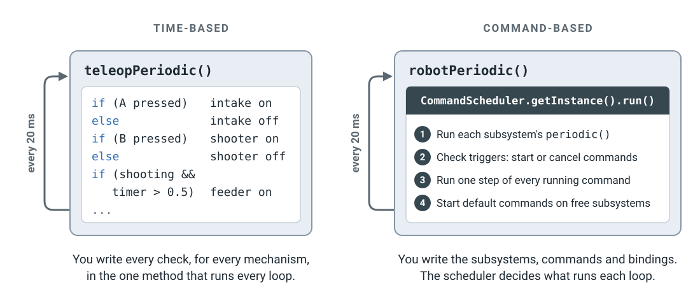

# From time-based to command-based

!!! quote "Why this page"

    I faced some trouble when transitioning from VEX time-based to FRC
    command-based programming, so I want to have this dedicated section to
    explain the past Commands v2 structure.

If you've written robot code with `TimedRobot`, you've written the loop
yourself: every 20 ms the robot calls `teleopPeriodic()`, and your code reads
the controller and sets every motor. Command-based code runs on the same 20 ms
loop, but you stop writing what goes inside it. WPILib's **command scheduler**
runs in the loop instead, and you tell it what to do once, when the robot
starts.

This page uses **Commands v2**, the version for the roboRIO (WPILib 2026 and
earlier). frcsoftware.org teaches the newer Commands v3. The ideas are the
same, and [the last section](#commands-v3) shows what changes.

## Who runs the loop

<figure class="diagram" markdown="span">
  [](../assets/images/software/command-based-loop.svg)
  <figcaption>
    Both run every 20 ms. The difference is who decides what happens inside
    the loop.
  </figcaption>
</figure>

In **time-based** code, everything happens inside the periodic methods. Check
A, set the intake. Check B, set the shooter. Watch a timer to know when to
start the feeder. Each new button or mechanism adds more `if`s to the same
method, and nothing stops two of them from setting the same motor.

In **command-based** code, `robotPeriodic()` has one line:

```java
CommandScheduler.getInstance().run();
```

Every loop, the scheduler does four things, in this order:

1.  **Runs each subsystem's `periodic()`**, for things that should always
    happen, like putting a sensor reading on the dashboard.
2.  **Checks every trigger**, such as a button, and starts or cancels the
    commands bound to it.
3.  **Runs one step of every running command**, and ends any that are done.
4.  **Starts the default command** on any subsystem no command is using.

You don't write this loop. You write the pieces it works with.

## The three pieces

<figure class="diagram" markdown="span">
  [](../assets/images/software/command-based-pieces.svg)
  <figcaption>
    The grey text at the bottom of each box is the file it's written in.
  </figcaption>
</figure>

| Piece | What it is | Example |
|---|---|---|
| **Subsystem** | One part of the robot and the hardware it owns. Only its own commands touch its motors. | `Intake`, which owns the intake motor |
| **Command** | One action. It *requires* the subsystems it uses. | `intake.runIn()`: run the intake motor at 80&nbsp;% |
| **Trigger** | Something that's either true or false, usually a button. You bind commands to it. | `driver.a()`: true while A is held |

Two rules keep everything in order:

- **One command per subsystem at a time.** When a new command needs a
  subsystem that's already in use, the scheduler interrupts the old command
  first. Two commands can never fight over the same motor.
- **When a subsystem is free, its default command runs.** For an intake,
  that's usually "stop".

## The simplest example

The intake runs while the driver holds A, and stops when they let go. Each
project below works like a small VS Code window: click a file in the explorer
to see its code.

Imports are left out. In VS Code, hover over a name with a red underline and
pick **Quick Fix** to add its import. `PWMSparkMax` is a motor controller on a
PWM port; any other motor controller works the same way.

**Time-based**, the way you'd write it now. Everything is in `Robot.java`:

<div class="vscode" markdown>
<div class="vscode__titlebar">time-based robot</div>
<div class="vscode__body" markdown>
<nav class="vscode__sidebar" aria-label="Files">
<div class="vscode__heading">Explorer</div>
<div class="vscode__folder" style="--depth: 0">src/main/java/frc/robot</div>
<button type="button" class="vscode__file" style="--depth: 1" data-file="main">Main.java</button>
<button type="button" class="vscode__file is-active" style="--depth: 1" data-file="robot">Robot.java</button>
</nav>
<div class="vscode__editor" markdown>
<div class="vscode__tabs"><span class="vscode__tab"></span></div>
<div class="vscode__crumbs"></div>
<div class="vscode__panes" markdown>
<div class="vscode__pane" data-file="robot" data-path="src/main/java/frc/robot/Robot.java" markdown>

```java linenums="1"
public class Robot extends TimedRobot {
  private final PWMSparkMax motor = new PWMSparkMax(0);
  private final XboxController driver =
      new XboxController(0);

  @Override
  public void teleopPeriodic() {
    if (driver.getAButton()) {
      motor.set(0.8);
    } else {
      motor.set(0);
    }
  }
}
```

<div class="vscode__note" markdown>
**Everything happens here.** The robot calls `teleopPeriodic()` every 20 ms,
and your code checks the A button and sets the motor.
</div>
</div>
<div class="vscode__pane" data-file="main" data-path="src/main/java/frc/robot/Main.java" markdown>

```java linenums="1"
public final class Main {
  private Main() {}

  public static void main(String... args) {
    RobotBase.startRobot(Robot::new);
  }
}
```

<div class="vscode__note" markdown>
Starts the robot. You never change this file.
</div>
</div>
</div>
</div>
</div>
</div>

**Command-based**, the same robot. WPILib's **Command Robot** template sets up
these files for you. Start with `Intake.java`, then `RobotContainer.java`, then
`Robot.java`:

<div class="vscode" markdown>
<div class="vscode__titlebar">command-based robot</div>
<div class="vscode__body" markdown>
<nav class="vscode__sidebar" aria-label="Files">
<div class="vscode__heading">Explorer</div>
<div class="vscode__folder" style="--depth: 0">src/main/java/frc/robot</div>
<div class="vscode__folder" style="--depth: 1">subsystems</div>
<button type="button" class="vscode__file is-active" style="--depth: 2" data-file="intake">Intake.java</button>
<button type="button" class="vscode__file" style="--depth: 1" data-file="main">Main.java</button>
<button type="button" class="vscode__file" style="--depth: 1" data-file="robot">Robot.java</button>
<button type="button" class="vscode__file" style="--depth: 1" data-file="container">RobotContainer.java</button>
</nav>
<div class="vscode__editor" markdown>
<div class="vscode__tabs"><span class="vscode__tab"></span></div>
<div class="vscode__crumbs"></div>
<div class="vscode__panes" markdown>
<div class="vscode__pane" data-file="intake" data-path="src/main/java/frc/robot/subsystems/Intake.java" markdown>

```java linenums="1"
public class Intake extends SubsystemBase {
  private final PWMSparkMax motor = new PWMSparkMax(0);

  // Runs the intake in until something cancels it
  public Command runIn() {
    return run(() -> motor.set(0.8));
  }

  // Holds the intake still
  public Command stop() {
    return run(() -> motor.set(0));
  }
}
```

<div class="vscode__note" markdown>
**The subsystem and its commands.** The subsystem owns the motor and has a
method for each thing it can do. Each method returns a command, but doesn't
decide *when* it runs. `run(...)` makes a command that runs the code inside
once every loop, and requires this subsystem.
</div>
</div>
<div class="vscode__pane" data-file="container" data-path="src/main/java/frc/robot/RobotContainer.java" markdown>

```java linenums="1"
public class RobotContainer {
  private final Intake intake = new Intake();
  private final CommandXboxController driver =
      new CommandXboxController(0);

  public RobotContainer() {
    intake.setDefaultCommand(intake.stop());
    driver.a().whileTrue(intake.runIn());
  }
}
```

<div class="vscode__note" markdown>
**The bindings.** `RobotContainer` creates the subsystems and connects
triggers to commands. Its constructor runs once, when the robot starts.
`whileTrue` starts `runIn()` when A is pressed and cancels it when A is
released.
</div>
</div>
<div class="vscode__pane" data-file="robot" data-path="src/main/java/frc/robot/Robot.java" markdown>

```java linenums="1"
public class Robot extends TimedRobot {
  private final RobotContainer robotContainer =
      new RobotContainer();

  @Override
  public void robotPeriodic() {
    CommandScheduler.getInstance().run();
  }
}
```

<div class="vscode__note" markdown>
**The loop.** `Robot` creates the `RobotContainer`, which sets up the
bindings, and runs the scheduler every loop. The template already has this,
so you rarely change it.
</div>
</div>
<div class="vscode__pane" data-file="main" data-path="src/main/java/frc/robot/Main.java" markdown>

```java linenums="1"
public final class Main {
  private Main() {}

  public static void main(String... args) {
    RobotBase.startRobot(Robot::new);
  }
}
```

<div class="vscode__note" markdown>
Starts the robot. You never change this file.
</div>
</div>
</div>
</div>
</div>
</div>

There's no `if (A pressed)` anywhere. The scheduler checks A for you, every
loop.

## Pressing A, loop by loop

<figure class="diagram" markdown="span">
  [](../assets/images/software/command-based-timeline.svg)
  <figcaption>
    The driver holds A for five loops, about a tenth of a second.
  </figcaption>
</figure>

1.  **Loops 1–3:** nothing needs the Intake, so its default command `stop()`
    runs and holds the motor at 0.
2.  **Loop 4:** the scheduler checks triggers and sees A held, so `whileTrue`
    starts `runIn()`. `runIn()` requires the Intake, which `stop()` is using,
    so the scheduler interrupts `stop()` first.
3.  **Loops 4–8:** every loop, the scheduler runs one step of `runIn()`, which
    sets the motor to 80&nbsp;%.
4.  **Loop 9:** A is released, so `whileTrue` cancels `runIn()`. The Intake is
    free, so at the end of the same loop the scheduler starts `stop()` again.

### Inside a command

The bottom row of the picture shows the parts of a command. Every command has
four, and the scheduler calls each one at a set time:

| Part | When the scheduler calls it |
|---|---|
| `initialize()` | Once, when the command starts |
| `execute()` | Every loop while it runs |
| `isFinished()` | Every loop, after `execute()`. Returning `true` ends the command. |
| `end(interrupted)` | Once, when it finishes or gets cancelled |

`run(...)` puts your code in `execute()` and never finishes by itself, so it
runs until a trigger cancels it or another command interrupts it. A few other
ways to make a command cover most needs:

| Code | What the command does |
|---|---|
| `runOnce(() -> ...)` | Runs the code once, then finishes |
| `startEnd(() -> a, () -> b)` | Runs `a` when it starts and `b` when it ends |
| `run(...).withTimeout(2)` | Like `run(...)`, but ends after 2 seconds |
| `first.andThen(second)` | Runs `first`, then `second`. This replaces step counters in auto. |

## Commands v3

frcsoftware.org's
[Stage 1B](https://frcsoftware.org/learning-course/stage1/stage1b/stage-overview/)
teaches command-based with **Commands v3**, new in WPILib 2027 for the
Systemcore. The scheduler, triggers and one command per part of the robot work
the same way. The main changes:

| Commands v2 (this page) | Commands v3 |
|---|---|
| Subsystem: `extends SubsystemBase` | Mechanism: `implements Mechanism` |
| `CommandScheduler.getInstance().run()` | `Scheduler.getDefault().run()` |
| A command is split into `initialize()`, `execute()`, `isFinished()` and `end()` | A command is one block of code that loops with `while`. `coroutine.yield()` waits for the next loop. |
| A new command always interrupts the old one | Commands have a priority. The higher one keeps the mechanism. |

## Learn more

- WPILib:
  [What Is "Command-Based" Programming?](https://docs.wpilib.org/en/stable/docs/software/commandbased/what-is-command-based.html),
  [The Command Scheduler](https://docs.wpilib.org/en/stable/docs/software/commandbased/command-scheduler.html)
  and
  [Structuring a Command-Based Robot Project](https://docs.wpilib.org/en/stable/docs/software/commandbased/structuring-command-based-project.html)
- frcsoftware.org:
  [The Concepts](https://frcsoftware.org/learning-course/stage1/stage1b/command-based-overview/)
  and the rest of Stage 1B, which ends with rewriting a time-based kitbot as
  command-based
