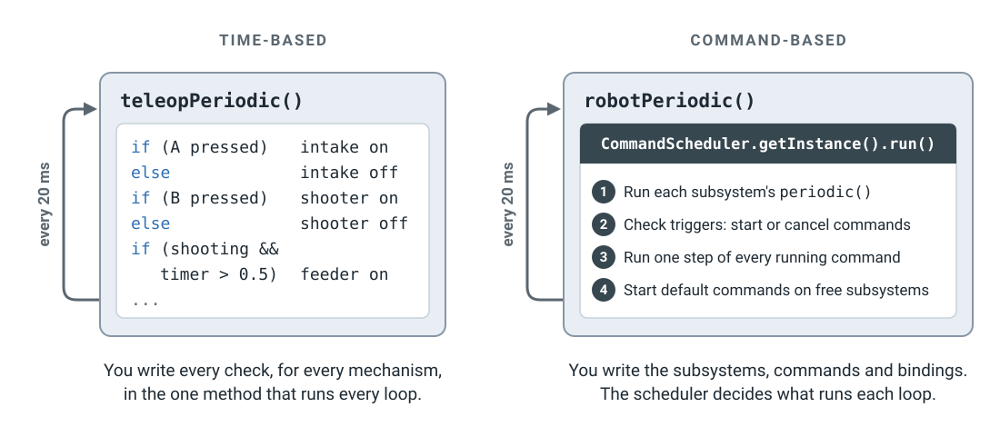
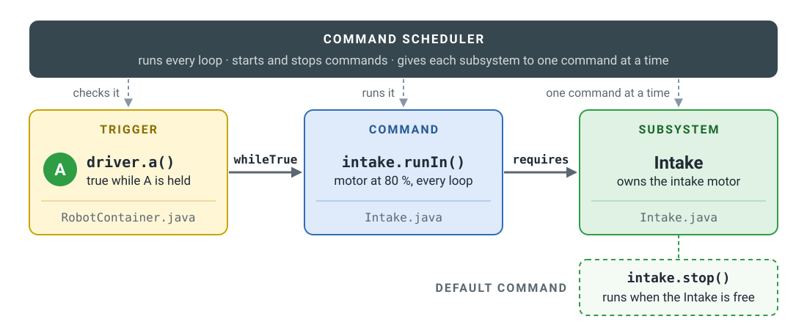
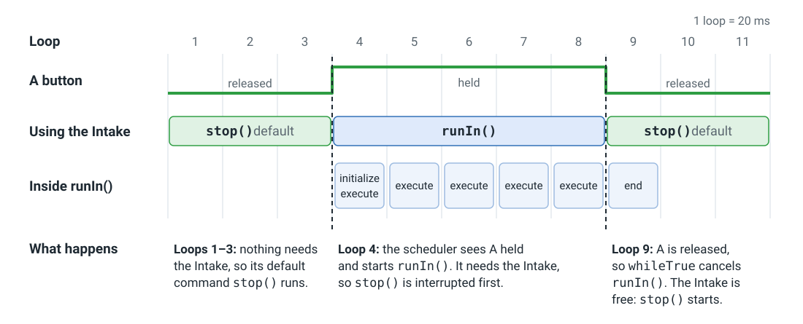

# 从基于时间到基于命令 { #from-time-based-to-command-based }

!!! quote "为什么有这一页"

    我从 VEX 的基于时间编程转到 FRC 的基于命令编程时遇到了一些困难，所以想专门用这一节来讲解之前的 Commands v2 结构。

如果你用 `TimedRobot` 写过机器人代码，那循环就是你自己写的：机器人每 20 ms 调用一次 `teleopPeriodic()`，你的代码读取手柄，然后设置每一个电机。基于命令（command-based）的代码运行在同样的 20 ms 循环上，但你不再自己写循环里面的内容。取而代之的是 WPILib 的**命令调度器**在循环里运行，你只需要在机器人启动时告诉它一次要做什么。

这一页使用的是 **Commands v2**，也就是 roboRIO 上用的版本（WPILib 2026 及更早）。frcsoftware.org 教的是更新的 Commands v3。两者的思路是一样的，[最后一节](#commands-v3)会讲有哪些变化。

## 谁来运行循环 { #who-runs-the-loop }

<figure class="diagram" markdown="span">
  [](../assets/images/software/command-based-loop.svg)
  <figcaption>
    两者都每 20 ms 运行一次。区别在于由谁来决定循环里发生什么。
  </figcaption>
</figure>

在**基于时间**的代码里，所有事情都发生在 periodic 方法里。检查 A，设置吸取机构。检查 B，设置发射机构。盯着计时器，判断什么时候启动送料机构。每加一个按钮或机构，同一个方法里就多几个 `if`，而且没有什么能阻止其中两个同时设置同一个电机。

在**基于命令**的代码里，`robotPeriodic()` 只有一行：

```java
CommandScheduler.getInstance().run();
```

每次循环，调度器按顺序做四件事：

1.  **运行每个子系统的 `periodic()`**，处理那些应该一直进行的事情，比如把传感器读数显示到仪表盘上。
2.  **检查每一个触发器**，比如一个按钮，然后启动或取消绑定在它上面的命令。
3.  **把每个正在运行的命令执行一步**，并结束已经完成的命令。
4.  **在没有被任何命令使用的子系统上启动默认命令。**

这个循环不需要你来写。你要写的是它用到的那些组件。

## 三种组件 { #the-three-pieces }

<figure class="diagram" markdown="span">
  [](../assets/images/software/command-based-pieces.svg)
  <figcaption>
    每个方框底部的灰色文字是它所在的文件。
  </figcaption>
</figure>

| 组件 | 是什么 | 例子 |
|---|---|---|
| **子系统**（subsystem） | 机器人的一个部分，以及它拥有的硬件。只有它自己的命令能操作它的电机。 | `Intake`，拥有吸取机构的电机 |
| **命令**（command） | 一个动作。它会*占用*（require）它要用到的子系统。 | `intake.runIn()`：让吸取电机以 80&nbsp;% 运行 |
| **触发器**（trigger） | 一个非真即假的东西，通常是一个按钮。你把命令绑定到它上面。 | `driver.a()`：按住 A 时为真 |

有两条规则让一切井然有序：

- **一个子系统同一时间只能有一个命令。**当一个新命令需要的子系统已经被占用时，调度器会先打断旧的命令。两个命令永远不会争抢同一个电机。
- **子系统空闲时，运行它的默认命令。**对吸取机构来说，通常就是"停止"。

## 最简单的例子 { #the-simplest-example }

操作手按住 A 时吸取机构运转，松开时停止。下面的每个项目都像一个小小的 VS Code 窗口：点击资源管理器里的文件就能看到它的代码。

代码里省略了 import。在 VS Code 里，把鼠标悬停在带红色波浪线的名字上，选择**快速修复**（Quick Fix）就能加上它的 import。`PWMSparkMax` 是接在 PWM 端口上的电机控制器；换成其他电机控制器也是一样的写法。

**基于时间**，也就是你现在的写法。所有东西都在 `Robot.java` 里：

<div class="vscode" markdown>
<div class="vscode__titlebar">基于时间的机器人</div>
<div class="vscode__body" markdown>
<nav class="vscode__sidebar" aria-label="文件">
<div class="vscode__heading">资源管理器</div>
<div class="vscode__folder" style="--depth: 0">src/main/java/frc/robot</div>
<button type="button" class="vscode__file" style="--depth: 1" data-file="main">Main.java</button>
<button type="button" class="vscode__file is-active" style="--depth: 1" data-file="robot">Robot.java</button>
</nav>
<div class="vscode__editor" markdown>
<div class="vscode__tabs"><span class="vscode__tab"></span></div>
<div class="vscode__crumbs"></div>
<div class="vscode__panes" markdown>
<div class="vscode__pane" data-file="robot" data-path="src/main/java/frc/robot/Robot.java" markdown>

```java linenums="1"
public class Robot extends TimedRobot {
  private final PWMSparkMax motor = new PWMSparkMax(0);
  private final XboxController driver =
      new XboxController(0);

  @Override
  public void teleopPeriodic() {
    if (driver.getAButton()) {
      motor.set(0.8);
    } else {
      motor.set(0);
    }
  }
}
```

<div class="vscode__note" markdown>
**所有事情都发生在这里。**机器人每 20 ms 调用一次 `teleopPeriodic()`，你的代码检查 A 按钮并设置电机。
</div>
</div>
<div class="vscode__pane" data-file="main" data-path="src/main/java/frc/robot/Main.java" markdown>

```java linenums="1"
public final class Main {
  private Main() {}

  public static void main(String... args) {
    RobotBase.startRobot(Robot::new);
  }
}
```

<div class="vscode__note" markdown>
启动机器人。你永远不需要改这个文件。
</div>
</div>
</div>
</div>
</div>
</div>

**基于命令**，同一台机器人。WPILib 的 **Command Robot** 模板会帮你建好这些文件。先看 `Intake.java`，再看 `RobotContainer.java`，最后看 `Robot.java`：

<div class="vscode" markdown>
<div class="vscode__titlebar">基于命令的机器人</div>
<div class="vscode__body" markdown>
<nav class="vscode__sidebar" aria-label="文件">
<div class="vscode__heading">资源管理器</div>
<div class="vscode__folder" style="--depth: 0">src/main/java/frc/robot</div>
<div class="vscode__folder" style="--depth: 1">subsystems</div>
<button type="button" class="vscode__file is-active" style="--depth: 2" data-file="intake">Intake.java</button>
<button type="button" class="vscode__file" style="--depth: 1" data-file="main">Main.java</button>
<button type="button" class="vscode__file" style="--depth: 1" data-file="robot">Robot.java</button>
<button type="button" class="vscode__file" style="--depth: 1" data-file="container">RobotContainer.java</button>
</nav>
<div class="vscode__editor" markdown>
<div class="vscode__tabs"><span class="vscode__tab"></span></div>
<div class="vscode__crumbs"></div>
<div class="vscode__panes" markdown>
<div class="vscode__pane" data-file="intake" data-path="src/main/java/frc/robot/subsystems/Intake.java" markdown>

```java linenums="1"
public class Intake extends SubsystemBase {
  private final PWMSparkMax motor = new PWMSparkMax(0);

  // 让吸取机构向内转，直到有东西取消它
  public Command runIn() {
    return run(() -> motor.set(0.8));
  }

  // 让吸取机构保持不动
  public Command stop() {
    return run(() -> motor.set(0));
  }
}
```

<div class="vscode__note" markdown>
**子系统和它的命令。**子系统拥有电机，它能做的每件事都对应一个方法。每个方法返回一个命令，但并不决定它*什么时候*运行。`run(...)` 创建一个命令，每次循环运行一次里面的代码，并占用这个子系统。
</div>
</div>
<div class="vscode__pane" data-file="container" data-path="src/main/java/frc/robot/RobotContainer.java" markdown>

```java linenums="1"
public class RobotContainer {
  private final Intake intake = new Intake();
  private final CommandXboxController driver =
      new CommandXboxController(0);

  public RobotContainer() {
    intake.setDefaultCommand(intake.stop());
    driver.a().whileTrue(intake.runIn());
  }
}
```

<div class="vscode__note" markdown>
**绑定。**`RobotContainer` 创建子系统，并把触发器和命令连接起来。它的构造函数在机器人启动时运行一次。`whileTrue` 在按下 A 时启动 `runIn()`，松开 A 时取消它。
</div>
</div>
<div class="vscode__pane" data-file="robot" data-path="src/main/java/frc/robot/Robot.java" markdown>

```java linenums="1"
public class Robot extends TimedRobot {
  private final RobotContainer robotContainer =
      new RobotContainer();

  @Override
  public void robotPeriodic() {
    CommandScheduler.getInstance().run();
  }
}
```

<div class="vscode__note" markdown>
**循环。**`Robot` 创建 `RobotContainer`（它会设置好绑定），并且每次循环都运行调度器。模板里已经写好了，所以你很少需要改它。
</div>
</div>
<div class="vscode__pane" data-file="main" data-path="src/main/java/frc/robot/Main.java" markdown>

```java linenums="1"
public final class Main {
  private Main() {}

  public static void main(String... args) {
    RobotBase.startRobot(Robot::new);
  }
}
```

<div class="vscode__note" markdown>
启动机器人。你永远不需要改这个文件。
</div>
</div>
</div>
</div>
</div>
</div>

任何地方都没有 `if (A pressed)`。调度器每次循环都会替你检查 A。

## 按下 A，一个循环一个循环地看 { #pressing-a-loop-by-loop }

<figure class="diagram" markdown="span">
  [](../assets/images/software/command-based-timeline.svg)
  <figcaption>
    操作手按住 A 五个循环，大约十分之一秒。
  </figcaption>
</figure>

1.  **第 1–3 个循环：**没有命令需要 Intake，所以运行它的默认命令 `stop()`，让电机保持在 0。
2.  **第 4 个循环：**调度器检查触发器，发现 A 被按住，于是 `whileTrue` 启动 `runIn()`。`runIn()` 要占用 Intake，而 `stop()` 正在用它，所以调度器先打断 `stop()`。
3.  **第 4–8 个循环：**每次循环，调度器都把 `runIn()` 执行一步，把电机设置为 80&nbsp;%。
4.  **第 9 个循环：**A 松开了，`whileTrue` 取消 `runIn()`。Intake 空闲了，所以在同一个循环的最后，调度器又启动 `stop()`。

### 命令的内部 { #inside-a-command }

图的最下面一行展示了命令的各个部分。每个命令都有四个部分，调度器在固定的时间调用每一个：

| 部分 | 调度器什么时候调用它 |
|---|---|
| `initialize()` | 命令启动时调用一次 |
| `execute()` | 运行期间每次循环都调用 |
| `isFinished()` | 每次循环，在 `execute()` 之后调用。返回 `true` 就结束命令。 |
| `end(interrupted)` | 命令完成或被取消时调用一次 |

`run(...)` 把你的代码放进 `execute()`，并且永远不会自己结束，所以它会一直运行，直到被触发器取消或者被另一个命令打断。下面几种创建命令的方式能满足大多数需求：

| 代码 | 命令做什么 |
|---|---|
| `runOnce(() -> ...)` | 运行一次代码，然后结束 |
| `startEnd(() -> a, () -> b)` | 启动时运行 `a`，结束时运行 `b` |
| `run(...).withTimeout(2)` | 和 `run(...)` 一样，但 2 秒后结束 |
| `first.andThen(second)` | 先运行 `first`，再运行 `second`。在自动阶段里，它取代了步骤计数器。 |

## Commands v3 { #commands-v3 }

frcsoftware.org 的 [Stage 1B](https://frcsoftware.org/learning-course/stage1/stage1b/stage-overview/) 用 **Commands v3** 来教基于命令编程，这是 WPILib 2027 为 Systemcore 新推出的版本。调度器、触发器以及"机器人的每个部分同一时间只有一个命令"的规则都和以前一样。主要的变化有：

| Commands v2（本页） | Commands v3 |
|---|---|
| 子系统：`extends SubsystemBase` | 机构：`implements Mechanism` |
| `CommandScheduler.getInstance().run()` | `Scheduler.getDefault().run()` |
| 一个命令被拆成 `initialize()`、`execute()`、`isFinished()` 和 `end()` | 一个命令就是一段用 `while` 循环的代码。`coroutine.yield()` 会等待下一次循环。 |
| 新命令总是会打断旧命令 | 命令有优先级。优先级高的那个保留机构。 |

## 了解更多 { #learn-more }

- WPILib：[What Is "Command-Based" Programming?](https://docs.wpilib.org/en/stable/docs/software/commandbased/what-is-command-based.html)（什么是"基于命令"的编程？）、[The Command Scheduler](https://docs.wpilib.org/en/stable/docs/software/commandbased/command-scheduler.html)（命令调度器）和 [Structuring a Command-Based Robot Project](https://docs.wpilib.org/en/stable/docs/software/commandbased/structuring-command-based-project.html)（组织基于命令的机器人项目）
- frcsoftware.org：[The Concepts](https://frcsoftware.org/learning-course/stage1/stage1b/command-based-overview/)（基本概念）以及 Stage 1B 的其余部分，最后会把一台基于时间的套件机器人改写成基于命令的
